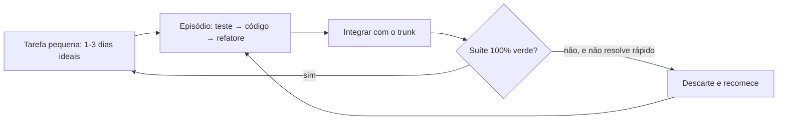

# XP (Beck): projeto simples, ciclos curtos e evidência

## 1. TL;DR

*Extreme Programming Explained* (Kent Beck, 1ª ed., 1999; trad. Bookman) aposta que a **curva de custo das modificações pode ser achatada** com três alavancas: projeto simples, testes automatizados e refatoração constante. Com mudança barata, a melhor estratégia é adiar decisões, entregar em incrementos pequenos e dirigir por feedback. A evidência empírica cobre partes isoladas: pair programming tem efeito pequeno e dependente da tarefa (meta-análise de 2009); CI, trunk-based e lotes pequenos têm apoio de estudos de repositórios e do programa DORA. Não achei estudo que valide o pacote das 12 práticas ou a tese da sinergia.

## 2. Problema que resolve

- **Risco** como problema central do software: cronograma estoura, projeto cancelado, sistema que degrada, requisito mal entendido ou que muda (cap. 1).
- Processos que tentam prever tudo no início e pagam caro quando a previsão erra.
- Qualidade sacrificada para cumprir data e escopo fixos ao mesmo tempo.
- Conhecimento preso a uma pessoa (propriedade individual de código) e integração rara e dolorosa.

**[fato]** A tese econômica (caps. 2-5): o custo de decidir hoje é o custo da decisão, mais os juros, mais a **inércia** que ela adiciona ao sistema. Sob incerteza, a opção de esperar vale muito. Adiar só compensa se mudar depois for barato, daí a importância da curva achatada.

## 3. Abordagens e trade-offs

### 3.1 Valores, princípios e as quatro variáveis

| Camada | Conteúdo |
|---|---|
| **Valores** (cap. 7) | Comunicação, simplicidade, feedback, coragem (e respeito, implícito) |
| **Princípios fundamentais** (cap. 8) | Feedback rápido, simplicidade presumida, mudanças incrementais, aceitação das mudanças, alta qualidade |
| **Atividades** (cap. 9) | Codificar, testar, ouvir, projetar |
| **Variáveis** (cap. 4) | Custo, tempo, qualidade, escopo |

**[fato]** Das quatro variáveis, o negócio fixa três e o time entrega a quarta. Fixar as quatro faz a qualidade sumir. O escopo é a variável mais maleável: falta tempo, corta-se escopo, não qualidade. Beck trata qualidade não como variável livre, mas como "excelente".

### 3.2 As 12 práticas (cap. 10) e a sinergia (cap. 11)

| Prática | Ideia | Ponto fraco compensado por |
|---|---|---|
| Jogo do Planejamento | Negócio decide escopo/prioridade/data; desenvolvimento estima e decide o como | Entregas curtas limitam o erro do plano |
| Entregas frequentes | Sistema simples em produção cedo; releases curtos, cada um coerente | Jogo do Planejamento escolhe o mais valioso |
| Metáfora | Uma história compartilhada no lugar da "arquitetura" | Feedback do código e refatoração |
| Projeto simples | O mais simples que passa os testes de hoje | Refatoração permite mudar amanhã |
| Testes | Unidade a 100% (programador); funcional em % (cliente) | Pares mantêm o hábito |
| Refatoração | Mudar estrutura sem mudar comportamento | Testes e propriedade coletiva |
| Programação em pares | Um digita (tático), outro pensa (estratégico) | Padrões de codificação, semana de 40h |
| Propriedade coletiva | Qualquer um muda qualquer código | Testes + integração em poucas horas |
| Integração contínua | Integrar a cada poucas horas, máx. 1 dia, com 100% verde | Testes rápidos |
| Semana de 40 horas | Nunca hora extra duas semanas seguidas | Planejamento realista |
| Cliente presente | Cliente real no time, respondendo na hora | Testes funcionais registram decisões |
| Padrões de codificação | Impossível saber quem escreveu o quê | Pares e propriedade coletiva |

**[fato]** Cada prática isolada tem um ponto fraco fatal; a força das outras o compensa. Segundo Beck, o valor pleno só aparece com (quase) todas juntas (cap. 23, regra 20-80). **[opinião]** É um argumento de design, não um resultado medido (ver seção 4).

### 3.3 Projeto simples (caps. 10, 17)

**[fato]** O projeto certo, a cada momento, segue quatro critérios **em ordem de prioridade**:

1. Roda todos os testes.
2. Comunica tudo o que precisa comunicar.
3. Não tem lógica duplicada (once and only once; cuidado com hierarquias paralelas).
4. Tem o menor número possível de classes e métodos.

**[fato]** A ordem entre 2 e 3 varia entre o cap. 10 e o cap. 17; nas formulações posteriores de Beck (as "4 rules of simple design") a ordem é testes → intenção → sem duplicação → menos elementos. O ponto estável: **comunicação vem antes de minimizar elementos**. Usar "menos classes/linhas" sozinho leva a métodos enormes e compressão ilegível.

| Decisão | Regra |
|---|---|
| Implementar agora ou adiar? | Adie, salvo se mudar depois for caríssimo ou a inércia adicionada for desprezível |
| Primeiro uso | Solução simples, específica |
| Segundo uso | Generalize |
| Grande reestruturação | Em passos pequenos, sem parar a entrega (exemplo da hierarquia de contratos, cap. 17) |
| Diagramas | 10-15 min para pensar, depois volte ao código; não mantenha sincronizados |

**[fato]** Projeto por eliminação (exercício de Tufte): parta de um sistema que passa os testes e apague tudo sem propósito comunicacional ou computacional.

### 3.4 Desenvolvimento e integração (cap. 16)

**[fato]** Nenhum código fica sem integrar por mais de algumas horas (máx. um dia). Se a integração não chega a 100% dos testes, joga-se o trabalho fora e recomeça. Refatoração constante quebra o sistema em partes pequenas, o que reduz colisões de integração.

**[fato]** Propriedade coletiva: quem vê código ruim é obrigado a melhorar. Só funciona com testes e integração curta. **[inferência]** Para um agente, esse princípio colide com a regra de não sair do escopo da tarefa (ver [`fowler-refactoring-2ed.md`](fowler-refactoring-2ed.md)); o equivalente seguro é **apontar** o problema, não corrigir por conta própria.

### 3.5 Testes (cap. 18)

**[fato]** Testar é apostar: só vale o teste que pode contrariar a expectativa. Teste o que pode falhar; código simples demais para falhar fica sem teste. Testes isolados (sem cascata de falhas) e automáticos. Em legado, testes **sob demanda** (ao adicionar função, corrigir bug, refatorar), nunca em massa. O ciclo test-first em detalhe está em [`beck-tdd.md`](../testing/beck-tdd.md); a escolha do que testar, em [`khorikov-unit-testing.md`](../testing/khorikov-unit-testing.md).

### 3.6 Planejamento e estimativa (cap. 15)

**[fato]** Estimativa em tempo ideal × fator de carga medido (~2-4). Quem implementa estima, e se candidata à tarefa antes de estimar (a "Síndrome da Primeira Terça" do C3 veio de estimar em grupo e distribuir depois). História: 1-5 semanas ideais; tarefa: 1-3 dias ideais.

### 3.7 Quando não usar (cap. 25)

**[fato]** Contraindicações listadas por Beck: curva de custo exponencial (mudar é desastroso), time grande (>~20), feedback lento (build de um dia, certificação de meses), impossível testar realisticamente, cultura de especificação gigante ou de hora extra, ambiente físico separado.

### 3.8 Edições

**[fato]** A 1ª edição (1999) tem 12 práticas e a "semana de 40 horas". A 2ª edição (2004, com Cynthia Andres) reorganiza em 5 valores (acrescenta respeito), 14 princípios, 13 práticas primárias e 11 corolárias, troca "40 horas" por *energized work* e põe ênfase em *sustainable pace*, deploy incremental e ciclo semanal/trimestral. Este doc segue a 1ª edição, que é a da skill consultada.

### 3.9 Anti-patterns

| Anti-pattern | Por quê |
|---|---|
| Projetar para o amanhã sob incerteza | O amanhã não chega ou você aprende algo melhor; paga para remover ou carregar o excesso |
| Fixar custo, tempo, qualidade e escopo | A qualidade some |
| Adotar uma prática isolada esperando todo o valor | O valor vem da combinação |
| Integrar raramente | Conflitos crescem, bugs ficam dias escondidos |
| Hora extra recorrente | Mascara processo quebrado e derruba as outras práticas |
| Testar tudo, inclusive o trivial | Testes sem valor matam o hábito |
| Testes interdependentes | Falsos negativos em cascata |
| Manter diagrama e código sincronizados | Dois formatos da mesma informação |

## 4. Evidência

- **Pacote XP e sinergia:** **[fato]** não achei estudo controlado que meça o efeito das 12 práticas juntas. A literatura sobre XP é majoritariamente de estudos de caso e relatos. A tese da sinergia é argumento do autor (**[opinião]** de Beck).
- **Pair programming:** **[fato]** a meta-análise de Hannay, Dybå, Arisholm e Sjøberg (IST, 2009) encontrou efeito positivo **pequeno** na qualidade, efeito médio na duração e efeito negativo no esforço, com alta heterogeneidade e sinais de viés de publicação. O efeito depende da complexidade: em tarefa simples, pares terminam mais rápido mas com menos qualidade; em tarefa complexa, mais qualidade com bem mais esforço. A afirmação de Beck de que pares são mais produtivos não se sustenta em geral.
- **Integração contínua:** **[fato]** Vasilescu et al. (ESEC/FSE 2015), em 246 projetos GitHub que adotaram Travis CI, observaram mais pull requests integrados por unidade de tempo sem aumento observável de bugs. É estudo observacional, com proxies (PRs mesclados, issues de bug fechadas).
- **Lotes pequenos e trunk-based:** **[fato]** o programa DORA (*Accelerate*, Forsgren, Humble e Kim, 2018) associa CI com trunk-based (branches de menos de um dia), automação de testes e trabalho em lotes pequenos a melhor desempenho de entrega. Os dados são de survey, com análise de correlação/estrutural, não experimento.
- **Projeto simples / YAGNI:** **[fato]** não achei estudo empírico que meça o efeito de adiar decisões de design. É opinião de praticantes, com apoio indireto da literatura sobre custo de complexidade.
- **Curva de custo achatada:** **[inferência]** a curva exponencial clássica (Boehm) vem de projetos em cascata dos anos 1970-80; a curva achatada de Beck é hipótese plausível para código com testes e refatoração, mas não achei medição direta.
- **Agentes de código:** **[fato]** não achei estudo que aplique práticas XP a agentes como intervenção. Estudos de mineração de 2026 (MSR) sobre PRs de agentes existem, mas tratam de reverts, churn e CI, não de práticas XP; não os verifiquei a ponto de citar números.

## 5. Aplicação prática

### 5.1 Em times

- Trate as quatro variáveis explicitamente na negociação de prazo: escopo é o ajuste.
- Branches curtos, integração diária, suíte verde como condição para integrar.
- Pair programming para tarefa complexa ou crítica; para tarefa simples, revisão assíncrona custa menos.
- Siga a ordem dos critérios de projeto simples na revisão de código: legibilidade antes de minimizar elementos.

### 5.2 Harnesses e agentes de IA

- **[opinião]** **Cliente presente → perguntar ao usuário.** O agente tem o "cliente" ao lado; requisito ambíguo vira pergunta, não suposição. Equivale à seção "Quando parar e perguntar" das rules.
- **[opinião]** **Escopo é o volante.** Se a tarefa não cabe, o agente deve propor cortar escopo (entregar parte coerente e listar o resto), nunca entregar tudo com qualidade menor (testes pulados, tratamento de erro omitido, `TODO` escondido).
- **[opinião]** **Integração contínua → incrementos verificáveis.** Mudança grande dividida em passos que deixam a suíte verde, cada um commitável. Um harness pode impor isso com hook que roda os testes antes de aceitar o fim do turno.
- **[opinião]** **Pares → navigator separado.** O par driver/navigator mapeia para agente que implementa + revisor (subagent ou usuário) com contexto independente. Dado o efeito pequeno e dependente de complexidade dos pares humanos, vale aplicar só em tarefa complexa ou de risco, não em toda mudança.
- **[opinião]** **Projeto simples contra a tendência do LLM.** Modelos tendem a gerar abstração, configuração e tratamento de casos que ninguém pediu. Os quatro critérios em ordem dão uma régua verificável na revisão do diff.
- **[opinião]** **Padrões de codificação → seguir o código vizinho.** O agente deve escrever como o resto do repo; "impossível saber quem escreveu" é um bom critério para código gerado.
- **[opinião]** **Propriedade coletiva não vale para agente.** O agente aponta o código ruim que encontrou; não o corrige fora do escopo sem pedido.

## 6. Fontes

- Beck, K. *Extreme Programming Explained: Embrace Change*. Addison-Wesley, 1999 (1ª ed.). Trad.: *Programação Extrema (XP) Explicada: Acolha as Mudanças*. Bookman.
- Beck, K.; Andres, C. *Extreme Programming Explained*, 2ª ed. Addison-Wesley, 2004 (citada de memória para a seção 3.8).
- Base de conhecimento extraída do livro (skill `programacao-extrema`, 16 arquivos de capítulo, glossário, padrões e cheatsheet). Consultada em 2026-11-18.
- Hannay, J. E.; Dybå, T.; Arisholm, E.; Sjøberg, D. I. K. "The effectiveness of pair programming: A meta-analysis". *Information and Software Technology* 51(7), 2009, p. 1110-1122: https://www.simula.no/research/effectiveness-pair-programming-meta-analysis. Consultado em 2026-11-18.
- Vasilescu, B. et al. "Quality and productivity outcomes relating to continuous integration in GitHub". ESEC/FSE 2015, p. 805-816: https://www.cs.ucdavis.edu/~filkov/papers/pr_soc_lan.pdf. Consultado em 2026-11-18.
- Forsgren, N.; Humble, J.; Kim, G. *Accelerate*. IT Revolution, 2018 (via skill `accelerate`, caps. 4 e 8). Consultado em 2026-11-18.
