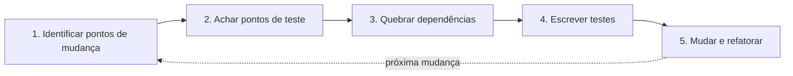

# Legacy Code (Feathers): seams, characterization tests e quebra de dependências

## 1. TL;DR

*Working Effectively with Legacy Code* (Michael Feathers, Prentice Hall, 2004) define legacy code como **código sem testes** e trata de um problema só: como colocar esse código sob teste para mudá-lo com segurança. O método é um algoritmo de 5 passos, apoiado em **seams** (pontos onde o comportamento muda sem editar ali), **characterization tests** (que fixam o comportamento atual, não o desejado) e um catálogo de 24 técnicas de quebra de dependência. Não achei estudo empírico que valide o método em si; a evidência nova vem de testes gerados por LLM, que ajudam a criar a rede de segurança mas podem **fixar bugs**.

## 2. Problema que resolve

- Código que precisa mudar mas não tem testes, e cujas dependências (banco, singletons, construtores pesados) impedem de escrever testes.
- O **dilema do legacy code**: para mudar com segurança é preciso ter testes; para ter testes é preciso mudar o código.
- Estratégias ruins por medo: "se não está quebrado, não mexa", hack inline em vários pontos, reescrever tudo.

**[fato]** O risco real não é a linha que muda, é não saber **quanto comportamento** está em risco. Três perguntas de toda mudança arriscada: o que precisa mudar? Como saber que fiz certo? Como saber que não quebrei nada? (cap. 1).

**[fato]** Evitar mudanças tem custo: classes e métodos crescem, a habilidade da equipe atrofia e o medo aumenta.

## 3. Abordagens e trade-offs

### 3.1 O algoritmo de mudança (cap. 2)

- **[fato] Cover and Modify × Edit and Pray:** mudar sob uma rede de testes (o "software vise", que trava o comportamento no lugar) em vez de editar com cuidado e torcer. Cuidado não é segurança.
- **[fato]** Cada episódio entrega a feature **e** os testes dela. As áreas testadas crescem como "ilhas saindo do oceano".
- **[fato]** Quebre dependências de forma **conservadora** para pôr o primeiro teste; a limpeza vem depois, com os testes no lugar.
- **[fato] Teste unitário** roda rápido e localiza o erro. Não é unitário se fala com banco, rede, filesystem ou exige configuração de ambiente. Um teste de 0,1 s já é lento.

### 3.2 Sensing e separation (cap. 3)

| Motivo para quebrar a dependência | Sintoma | Resposta |
|---|---|---|
| **Sensing** | Não dá para **ver** o efeito do código | Fake (ou mock) que registra o efeito |
| **Separation** | Não dá nem para **rodar** o código no harness | Extrair interface / injetar a dependência |

### 3.3 O modelo de seams (cap. 4)

**[fato]** Seam é um lugar onde se altera o comportamento **sem editar naquele lugar**. Todo seam tem um **enabling point**, onde se escolhe qual comportamento roda. Sem enabling point, não é seam.

| Tipo | Enabling point | Quando usar |
|---|---|---|
| **Object seam** | Qual objeto é passado/criado | Padrão em código OO: explícito e sustentável |
| **Link seam** | Classpath / linkagem | C/C++, dependência espalhada sem object seam |
| **Preprocessing seam** | Macros / defines | Só C/C++, último recurso |

### 3.4 Characterization tests (cap. 13)

**[fato]** Teste que documenta o comportamento **atual**, não o pretendido. Procedimento:

1. Ponha o trecho no harness.
2. Escreva uma asserção com um valor que você sabe que vai falhar.
3. Deixe a falha mostrar o valor real.
4. Troque a asserção para o valor real.
5. Repita até cobrir o que vai mudar.

- **[fato]** Não é black-box: leia o código e pare quando entender a área **e** conseguir detectar os efeitos da mudança que vai fazer.
- **[fato] Targeted testing:** confirme que os testes passam pelas linhas que vão mudar, inclusive branches e conversões de tipo. Um teste "dia de sol" pode passar sem exercitar a truncagem que uma extração vai quebrar. Verifique com sensing variable, debugger ou cobertura.
- **[fato] Method Use Rule:** antes de usar um método que não tem testes, escreva os testes dele.
- **[fato]** Comportamento surpreendente em código em produção: marque como suspeito, mantenha o teste e escale. Não "corrija" antes de saber quem depende dele.
- **[fato]** Escrever testes a partir da especificação ("o que deveria fazer") em legado vira caça a bugs; o que importa é o que o sistema **faz**.

### 3.5 Onde testar (caps. 11-12)

- **Effect sketch:** desenhar como os efeitos da mudança se propagam (retornos, parâmetros, campos, globais).
- **Interception point:** onde o efeito fica observável.
- **Pinch point:** ponto estreito em que um teste de nível mais alto cobre várias classes. Comece ali e, depois que as unidades ficarem testáveis, desça os testes.
- **[fato]** Trade-off: testes no pinch point tendem a virar mini-integração; quebre-os quando der.

### 3.6 Adicionar feature sem conseguir testar a classe (caps. 6, 8)

| Situação | Técnica |
|---|---|
| Classe testável | TDD direto |
| Não dá para testar a classe agora, novo sub-passo | **Sprout Method**: lógica nova num método novo, testado, chamado do código antigo |
| Nem dá para instanciar a classe | **Sprout Class** |
| Comportamento antes/depois do trabalho existente | **Wrap Method**: renomeia o antigo, cria um novo com a mesma assinatura que chama o novo comportamento + o antigo |
| Comportamento independente ou classe grande demais | **Wrap Class** (decorator se houver muitos chamadores) |
| Subclasse expressa bem a diferença | **Programming by Difference**, depois refatorar a herança para composição |

**[fato]** Sprout e wrap são cabeça de ponte, não destino: o ponto de chamada continua sem teste e é preciso voltar. Decorators empilhados viram cebola.

### 3.7 Catálogo de quebra de dependência (caps. 9, 10, 25)

| Obstáculo | Técnicas |
|---|---|
| Parâmetro de construtor difícil de falsificar | Extract Interface, Adapt Parameter |
| Objeto criado com `new` no construtor | Parameterize Constructor, Extract and Override Factory Method |
| Objeto criado dentro do método | Parameterize Method |
| Uma chamada com efeito colateral | Extract and Override Call, Subclass and Override Method |
| Singleton / global | Introduce Static Setter, Encapsulate Global References, Replace Global Reference with Getter |
| Utilitário estático | Introduce Instance Delegator |
| Método longo numa classe não instanciável | Break Out Method Object, Expose Static Method |
| Classe caríssima de instanciar | Primitivize Parameter (último recurso) |
| Aplicação dominada por chamadas a API externa | Skin and Wrap (API pequena) ou Responsibility-Based Extraction (API grande) |
| Código C | Link Substitution, Replace Function with Function Pointer |

**[fato]** Os mais usados: Extract Interface, Subclass and Override Method, Parameterize Constructor, Extract and Override Factory Method/Getter/Call e Introduce Static Setter.

**[fato]** Querer testar método privado indica que ele pertence a outra classe. Afrouxar o acesso só por conveniência é sinal de alerta.

### 3.8 Segurança sem testes (caps. 16, 20, 22, 23)

| Técnica | Como | Limite |
|---|---|---|
| **Lean on the Compiler** | Quebrar uma declaração de propósito; a lista de erros vira a lista de tarefas | Só em linguagem tipada; não confie em herança (override e variáveis sombreadas) |
| **Preserve Signatures** | Copiar listas de parâmetros inteiras, sem redigitar | n/a |
| **Single-Goal Editing** | Uma mudança por vez | n/a |
| **Hyperaware Editing** | Par ou TDD para perceber erros na hora | n/a |
| **Scratch Refactoring** | Refatorar livremente, sem testes, só para entender, e **descartar** | Nunca fazer commit do resultado |
| **Monster method** | Bulleted (sequencial) → extrair sequências; snarled (aninhado) → sensing variable, Extract What You Know, Break Out Method Object | Apoiar-se em refatoração automática |
| **Classe grande** | Primeiro parar o crescimento (Sprout Class/Method); depois achar responsabilidades (descobertas, não inventadas) e extrair aos poucos | Sem "binge" de refactoring no meio de um release |

### 3.9 Anti-patterns

| Anti-pattern | Por quê |
|---|---|
| "Se não está quebrado, não mexa" | Classes crescem, habilidade atrofia, medo aumenta |
| Hack inline em vários pontos sob pressão | Mistura responsabilidades e atrai mais código; "pague agora ou pague mais depois" |
| Append conveniente na classe grande | Origem das god classes |
| Reescrita como fuga | O legado continua recebendo features enquanto a reescrita não chega |
| Refactoring binge | Desestabiliza o sistema no meio de um release |
| Corrigir todo bug encontrado | Trabalho infinito; corrija só o que está no escopo |
| Espalhar testes por igual | Concentre onde muda mais, dói mais ou vale mais |
| Medir progresso contra 100% de cobertura | Leva ao desânimo; o progresso são as ilhas testadas |
| Commit de scratch refactoring | Nunca foi testado e era para ser jogado fora |

## 4. Evidência

| Afirmação | Status |
|---|---|
| O algoritmo de 5 passos e os seams tornam a mudança mais segura | **[opinião] do autor**, baseada em experiência de consultoria. Não achei estudo empírico que avalie o método ou o catálogo |
| Testes gerados por LLM ajudam a criar a rede de segurança | **Sustentada em escala industrial.** Alshahwan et al. (FSE 2024), TestGen-LLM na Meta: no Instagram, 75% dos testes compilaram, 57% passaram de forma confiável e 25% aumentaram cobertura; nos test-a-thons, melhorou 11,5% das classes e 73% das recomendações foram aceitas para produção. Os testes gerados **complementam** suítes existentes; não é o caso de código sem nenhum teste |
| Testes gerados que fixam o comportamento atual podem fixar bugs | **Indício recente, preprint.** arXiv 2610.11835 (out/2026), 145 PRs de SciPy, Qiskit e pandas: 8% a 17% dos testes gerados eram *fault-enforcing* (fixavam o defeito), contra 2,4% a 4,8% *fault-revealing*. O estudo é sobre mudanças novas, não sobre legado estável. **[inferência]** É exatamente o risco que Feathers aponta: characterization test documenta comportamento, não correção, e comportamento surpreendente precisa ser marcado e escalado |
| Testes gerados de characterization funcionam como rede para refactoring de legado | **Sem evidência direta.** Não achei estudo que meça isso |

**[opinião]** O livro é uma coleção de técnicas sólidas sem validação empírica formal, o que é comum em engenharia de software. A parte mais transferível e menos controversa é o algoritmo de 5 passos e a distinção characterization × especificação.

## 5. Aplicação prática

### 5.1 Backend

- Toda mudança em código sem teste segue o algoritmo: ponto de mudança → ponto de teste → quebrar dependência mínima → characterization test → mudança.
- Object seams via injeção pelo construtor resolvem a maior parte dos casos em linguagens modernas. Link e preprocessing seams quase só fazem sentido em C/C++.
- Introduce Static Setter para singletons é um degrau, não um destino: o objetivo é parar de usar o global. Ver também o anti-pattern de ambient context no [doc do Khorikov](../testing/khorikov-unit-testing.md).
- Sprout/Wrap como tática de prazo, com volta planejada.
- A rule derivada deste doc está em [`rules/legacy-code.md`](../../rules/legacy-code.md). O refactoring em si segue o [doc do Fowler](fowler-refactoring-2ed.md).

### 5.2 Harnesses e agentes de IA

**[inferência]** Agentes trabalham quase sempre em código que não escreveram, e muitas vezes sem testes suficientes. O algoritmo de Feathers vira um protocolo natural para o agente: primeiro a rede, depois a mudança.

Consequências **[opinião]**:

- **Characterization tests são o melhor uso de geração de testes por agente,** porque o oráculo é o próprio código atual: o agente roda, lê a falha e fixa o valor real. Não exige entender a intenção.
- **O risco é fixar bug como se fosse comportamento correto.** O agente deve marcar comportamento surpreendente como suspeito e avisar o usuário, nunca "corrigir" por conta própria. Os dados do preprint de 2026 indicam que o problema é real.
- **Targeted testing é verificável pelo harness:** medir cobertura das linhas do diff antes da mudança. Se as linhas que vão mudar não estão cobertas, o agente ainda não tem rede.
- **Scratch refactoring é barato para agente:** explorar uma reestruturação num worktree descartável para entender o código, e jogar fora. O harness pode garantir o descarte.
- **Lean on the Compiler / type checker como tool:** quebrar uma declaração de propósito e usar a lista de erros como lista de tarefas é um loop que agentes executam bem, com a ressalva de herança e sombreamento.
- **Sprout/Wrap limitam o diff:** em código sem teste, adicionar a lógica nova num método testado e só uma chamada no código antigo mantém a parte não testada do diff mínima e fácil de revisar.

## 6. Fontes

- Feathers, M. *Working Effectively with Legacy Code*. Prentice Hall, 2004. ISBN 9780131177055.
- Base de conhecimento extraída do livro (skill `working-effectively-legacy-code`, 25 capítulos, glossário, padrões e cheatsheet). Consultada em 2026-11-18.
- Alshahwan, N. et al. "Automated Unit Test Improvement using Large Language Models at Meta". FSE 2024 (industry track): https://arxiv.org/abs/2402.09171. Consultado em 2026-11-18.
- "On the Risks of using LLM-Generated Tests for Regression Testing" (preprint, out/2026): https://arxiv.org/pdf/2610.11835. Consultado em 2026-11-18.
