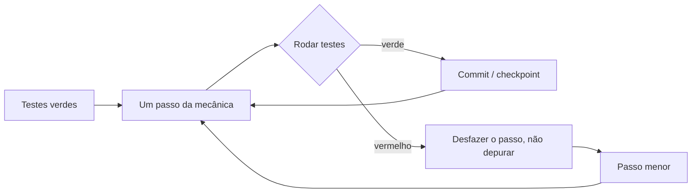

# Refactoring, 2ª edição (Fowler): princípios, catálogo e evidência

## 1. TL;DR

*Refactoring: Improving the Design of Existing Code*, 2ª ed. (Martin Fowler, com Kent Beck; Addison-Wesley, 2018) é quase uma reescrita do livro de 1999. Os exemplos passaram de Java para JavaScript, o foco saiu das classes e foi para funções e transformações de dados, e a **edição web virou a versão canônica**. A tese continua a mesma: mudar a estrutura em passos pequenos que preservam o comportamento, apoiados em testes, como parte do trabalho diário. A evidência empírica é **mista**. Código de baixa qualidade custa caro (dados fortes), mas "refatorar smells" nem sempre se paga. Em 2026 apareceu a primeira medição do benefício de refatorar para **agentes de código**: −83% de tokens de input por mudança, num experimento único.

## 2. Problema que resolve

- Código que funciona mas fica cada vez mais caro de mudar, porque o design se degrada a cada feature.
- A falsa escolha entre "reescrever tudo" e "não mexer no que funciona".
- Mudanças estruturais grandes, arriscadas, sem rede de segurança.

**[fato]** Definição do livro (cap. 2): refactoring é uma mudança na estrutura interna do software para torná-lo mais fácil de entender e mais barato de modificar, **sem alterar o comportamento observável**. O livro trata o termo com rigor. Se o código fica quebrado por dias durante a "refatoração", isso é reestruturação, não refactoring.

## 3. Abordagens e trade-offs

### 3.1 O que mudou da 1ª para a 2ª edição

**[fato]** Fonte: [The Second Edition of "Refactoring"](https://martinfowler.com/articles/refactoring-2nd-ed.html).

| Aspecto | 1ª ed. (1999) | 2ª ed. (2018) |
|---|---|---|
| Linguagem dos exemplos | Java | JavaScript (por ser popular, ter sintaxe estilo C e funções de primeira classe). Fowler diz que não é fã da linguagem |
| Unidade central | Classe/método | Função. As classes "still are valuable", mas o refactoring fica "less centered around them" |
| Catálogo | 68 refatorações | Reescrito. O print traz 63 (memo do autor). O [catálogo web](https://refactoring.com/catalog/) lista 66 |
| Renomeações | Extract Method, Inline Method… | Extract Function, Inline Function… (os nomes antigos viram aliases) |
| Novidades emblemáticas | n/a | Split Phase, Combine Functions into Transform, Replace Loop with Pipeline, Combine Functions into Class |
| Escopo | n/a | Sem áreas novas (regra autoimposta de não ampliar o escopo) |
| Formato | Livro | **Web-first**: a edição web é a canônica, o livro é um recorte dela, e 5 refatorações ficaram só na web |
| Impressão | P&B | Primeira em cores (para destacar as mudanças no código) |

**[fato]** Cada capítulo e cada refatoração foram reescritos, na maior parte do zero. Fowler estima que, para cada item que passou direto, dois exigiram repensar tudo.

**[fato]** Os números do próprio autor não fecham (68 − 10 + 17 = 75 ≠ 63), e o catálogo web tem 66. **[inferência]** A diferença vem das refatorações só da web e das que foram substituídas por outras parecidas.

### 3.2 Estrutura do livro

**[fato]** Sumário ([PDF do sumário](https://vlb-content.vorarlberg.at/fhbscan1/330900106019.pdf)):

| Cap. | Conteúdo |
|---|---|
| 1 | Exemplo completo: a função `statement` (faturas de uma companhia de teatro) decomposta passo a passo, incluindo Split Phase e polimorfismo |
| 2 | Princípios: definição, as duas hats, por que e quando refatorar, problemas, arquitetura e YAGNI, performance, ferramentas automáticas |
| 3 | Bad smells (com Kent Beck) |
| 4 | Building Tests: self-testing code como pré-requisito |
| 5 | Como ler o catálogo |
| 6–12 | Catálogo: primeiro conjunto básico, Encapsulation, Moving Features, Organizing Data, Simplifying Conditional Logic, Refactoring APIs, Dealing with Inheritance |

### 3.3 Princípios (cap. 2)

- **[fato] Duas hats.** Ou você adiciona funcionalidade (e testes), ou refatora (sem mudar comportamento). Alterna com frequência, mas nunca usa as duas ao mesmo tempo.
- **[fato] Quando refatorar:**
  - *Preparatory*: antes de uma feature, para que ela fique fácil ("make the change easy, then make the easy change", frase atribuída a Kent Beck);
  - *Comprehension*: para entender o código que está lendo;
  - *Litter-pickup*: limpar o que encontrar pelo caminho;
  - *Regra de três*: na terceira duplicação, refatore;
  - Refactoring **planejado** existe, mas deve ser raro. O normal é refatorar de forma oportunista, dentro do trabalho de feature.
- **[fato] Quando não refatorar:** código que não precisa ser mexido, ou quando reescrever sai mais barato.
- **[fato] Argumento econômico:** refatorar é o que mantém a velocidade de entrega. Ligado à *Design Stamina Hypothesis*, que o próprio Fowler chama de hipótese, sem dados rigorosos.
- **[fato] Performance:** escreva código claro, meça, e otimize só os hotspots. Código bem fatorado é mais fácil de otimizar.
- **[fato] YAGNI e arquitetura:** refactoring é o que torna viável o design incremental, sem especular flexibilidade antecipada.
- **[fato] Problemas:** feature branches longas brigam com refactoring (conflitos de merge). O livro defende integração contínua / trunk-based. APIs publicadas e bancos de dados exigem estratégias como parallel change e migrações.
- **[fato] Refatoração (substantivo) × refatorar (verbo):** a primeira é uma transformação nomeada do catálogo; a segunda é uma sessão que encadeia várias. "Reestruturação" é o termo genérico para qualquer limpeza; refactoring é o tipo disciplinado dela.
- **[fato] Justificativa:** o autor considera o argumento moral ou estético ("código limpo") o modo mais perigoso de defender refactoring. O argumento certo é econômico: entregar features e corrigir bugs mais rápido.
- **[fato] Três tipos de oportunismo:** preparatory (antes da feature), comprehension (gravar no código o entendimento, citando Ward Cunningham) e litter-pickup (corrigir na hora se for simples, anotar se for grande; "deixe o código um pouco melhor do que encontrou").
- **[fato] Ownership:** fronteiras de propriedade (API publicada, outro time) não impedem o refactoring, mas exigem compatibilidade (manter a declaração antiga como wrapper, deprecação gradual). O livro prefere ownership por time, com monitoramento em vez de bloqueio.
- **[fato] Técnicas de migração:** *parallel change* (expand-contract) para bancos e APIs; *branch by abstraction* para trocar uma biblioteca por outra sem quebrar o build.
- **[fato] Legado sem testes:** não refatorar tudo de uma vez; criar *seams* aos poucos, como em Feathers (*Working Effectively with Legacy Code*).
- **[fato] Três abordagens de performance:** time budgeting (só tempo real rígido), atenção constante (em geral contraproducente) e "fatorar bem, depois otimizar com profiler" (a recomendada, porque o tempo se concentra em pouco código).

### 3.4 Bad smells (cap. 3)

**[fato]** 24 smells na 2ª ed.: Mysterious Name, Duplicated Code, Long Function, Long Parameter List, Global Data, Mutable Data, Divergent Change, Shotgun Surgery, Feature Envy, Data Clumps, Primitive Obsession, Repeated Switches, Loops, Lazy Element, Speculative Generality, Temporary Field, Message Chains, Middle Man, Insider Trading, Large Class, Alternative Classes with Different Interfaces, Data Class, Refused Bequest, Comments.

**[inferência]** Comparando com a 1ª ed.: entraram **Mysterious Name, Global Data, Mutable Data e Loops**; *Switch Statements* virou **Repeated Switches** (só o switch repetido é smell); *Lazy Class* virou **Lazy Element**; *Inappropriate Intimacy* virou **Insider Trading**. A ênfase em dados mutáveis e globais combina com a virada para o estilo funcional.

**[fato]** O livro se recusa a dar métricas precisas para os smells e diz que nenhum conjunto de métricas substitui o julgamento humano.

Mapa dos smells mais comuns para as refatorações que os curam **[fato]** (cap. 3):

| Smell | Refatorações |
|---|---|
| Long Function | Extract Function, Replace Temp with Query, Decompose Conditional, Split Loop |
| Mysterious Name | Change Function Declaration, Rename Variable/Field |
| Duplicated Code | Extract Function, Slide Statements (alinhar antes), Pull Up Method |
| Long Parameter List | Introduce Parameter Object, Preserve Whole Object, Replace Parameter with Query, Remove Flag Argument |
| Global Data / Mutable Data | Encapsulate Variable (sempre primeiro), Split Variable, Separate Query from Modifier, Replace Derived Variable with Query |
| Divergent Change | Split Phase, Extract Class, Move Function |
| Shotgun Surgery | Move Function/Field, Combine Functions into Class/Transform; às vezes Inline antes de reorganizar |
| Feature Envy | Move Function (com Extract Function se só parte inveja) |
| Primitive Obsession | Replace Primitive with Object, Replace Type Code with Subclasses |
| Repeated Switches | Replace Conditional with Polymorphism |
| Speculative Generality | Collapse Hierarchy, Inline Function/Class, Remove Dead Code |
| Refused Bequest | Push Down Method/Field; Replace Subclass/Superclass with Delegate quando a interface é recusada |
| Comments | Extract Function, Rename, Introduce Assertion |

- **[fato]** Comentário não é smell em si: é "desodorante". Se o bloco precisa de comentário, extraia uma função com o nome do comentário.
- **[fato]** Só o `switch` **repetido** é smell. O livro rejeita a "guerra religiosa" contra condicionais.
- **[fato]** A raiz comum de Feature Envy, Insider Trading e Shotgun Surgery é dado e comportamento separados: "coloque junto o que muda junto".
- **[fato]** Em Refused Bequest, recusar implementação costuma ser aceitável; recusar a **interface** do pai é o caso grave.

### 3.5 O catálogo: formato de cada refatoração

**[fato]** Cada entrada traz: nome (+ aliases), sketch (antes/depois), **motivação** (quando e por quê), **mecânica** (passos pequenos, testando entre eles) e exemplos. As mais usadas formam o "primeiro conjunto" (cap. 6): Extract/Inline Function, Extract/Inline Variable, Change Function Declaration, Encapsulate Variable, Rename Variable, Introduce Parameter Object, Combine Functions into Class, Combine Functions into Transform e Split Phase.

Destaques da 2ª ed.:

| Refatoração | Ideia |
|---|---|
| **Split Phase** | Separar código que faz duas coisas em fases sequenciais com uma estrutura de dados intermediária (ex.: parse → cálculo → renderização) |
| **Combine Functions into Transform** | Juntar funções que derivam dados de um mesmo registro num transform que devolve o registro enriquecido |
| **Replace Loop with Pipeline** | Trocar loop imperativo por `map`/`filter`/`reduce` |
| **Replace Derived Variable with Query** | Tirar estado mutável derivado e calcular sob demanda |
| **Change Function Declaration** | Unifica Rename, Add/Remove Parameter, com uma mecânica "simples" e uma "de migração" (parallel change) |

**[fato]** Três formas complementares de agrupar funções relacionadas (cap. 6): **Combine Functions into Class** (dados mutáveis), **Combine Functions into Transform** (dados somente leitura) e **Split Phase** (processamento sequencial com preocupações distintas).

**[inferência]** A skill extraída da edição brasileira (Novatec) lista 61 refatorações nos caps. 6-12, contra 63 no print original segundo o autor. Não verifiquei se a diferença vem da tradução ou da extração.

### 3.6 Ritmo e mecânica segura

- **[fato]** Passos pequenos são **mais rápidos** no agregado: um passo que quebra tem uma única mudança suspeita. Se algo falha, reduza o passo (cap. 1).
- **[fato] Copiar antes de cortar** (cap. 8): copiar para o destino → adaptar → validar (estática + testes) → original vira delegação → opcionalmente internalizar.
- **[fato] Dados exigem mais cautela que funções** (cap. 6): não dá para "encaminhar" uma variável movida. Encapsule antes; isso transforma o problema de mover dados no de mover funções.
- **[fato] Slide Statements** tem regras de interferência (declaração, referência, modificação). Código sem efeito colateral reordena livremente; com efeito colateral, só até não colidir com dados compartilhados. É quase sempre pré-requisito de Extract Function.
- **[fato]** Extração com muitas variáveis mutadas é sinal para recuar e simplificar antes (Split Variable, Replace Temp with Query).
- **[fato]** Substitute Algorithm exige isolar o código antigo numa função testável e comparar as saídas antes de aceitar a troca.
- **[fato]** Pares inversos (Extract/Inline, Hide Delegate/Remove Middle Man, Function/Command) mostram que decisões de estrutura são reversíveis: "refatoração significa nunca ter de se arrepender".

### 3.7 Testes como pré-requisito (cap. 4)

- **[fato] Self-testing code:** testes automatizados que verificam o próprio resultado, rodados a cada poucos minutos no trecho em trabalho e todos pelo menos uma vez por dia. Nunca refatore com barra vermelha.
- **[fato]** Confirme que o teste falha quando deveria: injete uma falha temporária e remova.
- **[fato] Characterization test em legado:** escreva com valor placeholder, rode, troque pelo valor real, injete falha para validar.
- **[fato]** Testes orientados a risco: concentre esforço onde é mais provável dar bug e sonde limites (vazio, zero, negativo, string vazia). Não teste getters/setters triviais.
- **[fato]** Nunca compartilhe fixture mutável entre testes: recrie a cada teste (`beforeEach`).
- **[fato]** Bug reportado: primeiro o teste que o expõe, depois a correção.
- **[fato]** Cobertura serve para achar áreas sem teste, não para avaliar a suíte.
- **[inferência]** Divergência com Khorikov: Fowler recomenda, como regra geral, uma verificação por teste (exceto asserts intimamente relacionados); Khorikov chama "um assert por teste" de regra errada. Na prática convergem: vários asserts só quando verificam o mesmo comportamento. A rule de testes deste repo segue a formulação do Khorikov.

### 3.8 Decisões frequentes (caps. 9-12)

| Situação | Decisão do livro |
|---|---|
| Caso excepcional que impede o resto | Guard clause. Dois caminhos igualmente normais → `if/else`. "Único ponto de saída" não é regra útil |
| Mesmo valor especial tratado igual em vários lugares | Introduce Special Case (null object) |
| Pressuposto implícito que deve ser sempre verdade | Introduce Assertion. Não para validar dados externos |
| Função que retorna valor e muda estado | Separate Query from Modifier (CQS) |
| Booleano/enum que só escolhe ramo | Remove Flag Argument: uma função explícita por caso |
| Parâmetro derivável pela função × dependência incômoda no corpo | Replace Parameter with Query × Replace Query with Parameter. Trade-off entre facilitar o chamador e manter transparência referencial |
| Campo fixado só na criação | Remove Setting Method |
| Função complexa precisa de estado, undo ou hooks | Replace Function with Command. Nos ~95% restantes, função simples |
| Variável recebe valor para dois propósitos | Split Variable |
| Dado derivado mantido em sincronia à mão | Replace Derived Variable with Query (validar com assertion antes de remover o antigo) |
| Cópias que deveriam compartilhar estado × subobjeto pequeno e imutável | Change Value to Reference × Change Reference to Value (value object com igualdade por valor) |
| Herança com segundo eixo de variação, subclasse que recusa a interface ou precisa mudar de tipo em runtime | Replace Subclass/Superclass with Delegate. Comece com herança e migre só quando o problema aparecer |

### 3.9 Anti-patterns (caps. 1-12)

| Anti-pattern | Por quê |
|---|---|
| Reservar semanas de "refatoração pura" no cronograma | Em geral vira reestruturação descuidada e reforça a ideia de que refactoring é atraso |
| Justificar por estética ou moral | Argumento frágil; o critério é velocidade de entrega |
| Otimização por atenção constante | Visão local, sem medição; piora a manutenibilidade sem ganho real |
| Feature branch longa | Custo de merge semântico cresce rápido; inimigo do refactoring frequente |
| Copiar e colar para variar comportamento | Toda mudança futura exige atualizar as cópias |
| Usar a lista de smells como checklist mecânica | Smells pedem julgamento |
| Autoencapsulamento generalizado | Se a classe precisa disso, deveria ser dividida |
| Polimorfismo ou asserção em excesso | Nem toda condicional vira hierarquia; asserção não valida entrada externa |
| Comentar código morto | O controle de versão já guarda |
| Juntar laços por medo de performance | Separar refactoring de otimização; só reunir com profiler |
| Deixar nome ruim "porque funciona" | Nome melhor entendido deve ser aplicado na hora |

### 3.10 Trade-offs

| Tensão | Posição do livro |
|---|---|
| Refatorar × entregar feature | Falsa dicotomia: preparatory refactoring acelera a feature |
| Passos pequenos × velocidade | Passos pequenos são mais rápidos no agregado (não se perde tempo depurando) |
| Clareza × performance | Clareza primeiro, otimização guiada por profiler |
| Feature branches × refactoring | Prefere CI/trunk-based |
| Rigor de mecânica × ferramenta automática | Use a IDE quando houver; a mecânica manual é para quando não houver |
| Ocultar delegação × intermediário | Sem regra fixa: depende do quanto a mudança no delegado deve ficar isolada versus o custo dos wrappers |
| Herança × delegação | Herança quando todo o comportamento do pai se aplica; delegação quando deixa de valer. Não antecipar delegação (generalidade especulativa) |

## 4. Evidência

| Afirmação | Status |
|---|---|
| Código de baixa qualidade custa mais tempo e gera mais defeitos | **Sustentada.** Tornhill & Borg (TechDebt 2022), 39 codebases proprietárias e 30.737 arquivos: código "Red" teve 15× mais defeitos e 124% mais tempo de desenvolvimento por tarefa que código "Healthy", com tempo máximo até 9× maior. A métrica é o Code Health, proprietário da CodeScene (empresa do primeiro autor). Há pacote de replicação público |
| Refatorar traz benefício mensurável | **Sustentada, mas com escopo limitado.** Kim, Zimmermann & Nagappan (FSE 2012 / TSE 2014), na Microsoft: os módulos do Windows 7 refatorados por um time dedicado tiveram redução significativa de dependências entre módulos e de defeitos pós-release. Os desenvolvedores, porém, percebem custo e risco altos, e usam "refactoring" num sentido mais amplo que o de transformação que preserva semântica |
| Refactoring é seguro (não introduz bugs) | **Contestada.** Bavota et al. (SCAM 2012), 3 sistemas Java: algumas refatorações (ex.: Pull Up Method, mexidas em hierarquia) induzem falhas com frequência. A replicação de Di Penta, Bavota & Zampetti (ESEC/FSE 2020, 103 sistemas) **confirmou** o resultado quantitativo, mas a análise manual mostrou que o papel do refactoring na introdução de bugs é menos claro (commits misturam refactoring com outras mudanças) |
| Code smells aumentam o esforço de manutenção | **Fraca.** Sjøberg et al. (TSE 2013), estudo controlado com 6 desenvolvedores profissionais: nenhum dos 12 smells aumentou o esforço de forma significativa depois de controlar por tamanho do arquivo e número de mudanças. Tamanho e frequência de mudança explicaram quase toda a variação. Amostra pequena |
| Na prática, refactoring é intercalado com feature ("floss refactoring") | **Sustentada.** Murphy-Hill, Parnin & Black (ICSE 2009 / TSE 2012): refatorações costumam ser intercaladas com outras mudanças, mensagens de commit não indicam refactoring de forma confiável e ferramentas automáticas são pouco usadas (cerca de 10% em amostras de Eclipse/Mylyn). Bate com a recomendação das "duas hats alternadas com frequência", mas mostra que na prática elas se misturam no mesmo commit |
| Design Stamina Hypothesis | **[opinião] do autor**, rotulada por ele mesmo como hipótese. O gráfico é ilustrativo, não é dado |
| Refatorar reduz custo para agentes de IA | **Indício inicial.** Edwards-Alexander (martinfowler.com, 2026-07-30): ver 5.2. N = 1, tokens estimados |
| Passos pequenos são mais rápidos no agregado | **[opinião] do autor**, baseada em experiência. Não achei estudo que meça diretamente |
| Fatorar bem e depois otimizar com profiler | **[opinião] do autor**, apoiada na observação de que o tempo de execução se concentra em pouco código. Não verifiquei estudo específico nesta revisão |

**[opinião]** Resumo honesto: a evidência apoia "qualidade de código importa" e "refatorar hotspots ajuda". Não apoia "todo smell deve ser eliminado". O próprio dado de Sjøberg aponta para tamanho e churn como os preditores fortes, o que sugere priorizar a refatoração pelo que muda com frequência (hotspot analysis, à la Tornhill), e não pela lista de smells.

## 5. Aplicação prática

### 5.1 Em backend / sistemas legados

- **Preparatory refactoring** como hábito: antes da feature, um commit só de estrutura; depois, o commit da feature. Facilita o review e o revert.
- **Split Phase** é o padrão mais útil em legado: separar parse/validação, regra de negócio e I/O. É o mesmo movimento do *functional core / imperative shell* e do *humble object* do Khorikov (ver [`software-engineering/testing/khorikov-unit-testing.md`](../testing/khorikov-unit-testing.md)).
- **Pré-requisito:** testes com alta resistência a refactoring (Khorikov). Testes acoplados à implementação travam refatorações; o pilar "resistência a refactoring" é literalmente a condição do livro do Fowler.
- **Priorize por churn × complexidade**, não por contagem de smells (ver evidência).
- **Change Function Declaration (versão de migração)** = parallel change / expand-contract. Vale também para APIs e schemas de banco. Para trocar biblioteca, branch by abstraction.
- **Legado sem testes:** characterization tests com placeholder + falha injetada, e seams incrementais, antes de qualquer refatoração.
- A rule derivada deste doc está em [`rules/refactoring.md`](../../rules/refactoring.md).

### 5.2 Em harnesses e agentes de IA

**[fato]** Experimento de Giles Edwards-Alexander (Thoughtworks), publicado no site do Fowler em 2026-07-30 ([fonte](https://martinfowler.com/articles/exploring-gen-ai/refactoring-economic-benefit.html)):

- App de ~150 kLoC (~120 kLoC Rust) escrita quase inteira por agentes (Claude Code, um pouco de Cursor), com um único arquivo de DAL de 17.155 linhas.
- Plano de refactoring baseado na 2ª ed., com cada passo testado. Uma "mudança representativa" foi executada em subagente novo após cada passo e depois descartada.
- Resultado final: o maior arquivo caiu 78,5% (17.155 → 3.695 linhas) e o **input por mudança caiu 83%** (159.564 → 27.360 tokens estimados). O output praticamente não mudou (+24%, ruído). O tempo subiu (342 s → 454 s), mas o próprio autor considera esse dado de tempo pouco confiável.
- Economia: cerca de US$ 0,40 por mudança, contra um custo de refactoring de até ~5M tokens (não medido com precisão).
- O ganho veio de o **agente ler menos código**, não de haver menos código (o total de LoC caiu só 3,2%). O passo decisivo foi quebrar o arquivo gigante em módulos.
- Limitações: N = 1, tokens estimados por chars/4. O Claude escolheu mal as refatorações (o primeiro plano não incluía a mais valiosa) e seus scripts grep/sed quebravam com indentação.

Consequências **[opinião]**:

- **Smells ganham custo explícito em tokens.** Large Class / arquivo gigante, Duplicated Code e Long Function fazem o agente carregar mais contexto por mudança. Para codebases mantidas por agentes, o "custo de leitura" deixa de ser hipótese e vira fatura.
- **Divisão de trabalho:** humano escolhe *quais* refatorações aplicar; agente executa a *mecânica*, em passos pequenos com testes entre eles. Isso bate com o achado do experimento e com o formato do catálogo (a mecânica é um algoritmo).
- **"Vermelho → desfaça, não depure" serve bem a agentes:** um agente que tenta consertar um passo quebrado tende a acumular mudanças. Reverter (git checkout do arquivo) e refazer com passo menor mantém o diff pequeno e verificável.
- **Mecânica como protocolo:** copiar antes de cortar e encapsular antes de mover viram passos que o harness pode checar (o original ainda existe como delegação? os testes rodaram entre os passos?).
- **Ferramenta > texto:** o problema do grep/sed indica que o harness deveria expor refatorações via LSP/IDE (rename, extract, move) como tools, em vez de edição textual. **[inferência]** Murphy-Hill mostrou que humanos usam pouco a refatoração automática; um agente não tem esse viés e se beneficiaria mais dela.
- **Duas hats no harness:** um modo/skill de "refactor" com invariantes verificáveis (testes verdes a cada passo, sem mudança de API pública, diff sem mudança de comportamento) separado do modo "feature". Um hook pode bloquear commits de refactoring que alterem testes.
- **Split Phase no próprio harness:** separar montagem de contexto → chamada do modelo → interpretação/execução de tool calls → persistência. Cada fase vira testável no estilo output-based.
- **Experimento a rodar** (`experiments/`): replicar o protocolo do Edwards-Alexander num codebase legado real, medindo tokens reais de billing em vez de chars/4.

## 6. Fontes

- Fowler, M. *Refactoring: Improving the Design of Existing Code*, 2nd ed. Addison-Wesley, 2018. ISBN 9780134757599. Consultado em 2026-11-17.
- Fowler, M. *Refatoração: Aperfeiçoando o Projeto de Código Existente*, 2ª ed. Novatec (tradução brasileira). Base de conhecimento extraída do livro (skill `fowler-refactoring`, caps. 1-12, glossário, catálogo e cheatsheet), usada na revisão das seções 3.3-3.10. Consultada em 2026-11-18.
- Fowler, M. "The Second Edition of 'Refactoring'": https://martinfowler.com/articles/refactoring-2nd-ed.html. Consultado em 2026-11-17.
- Catálogo online: https://refactoring.com/catalog/. Consultado em 2026-11-17.
- Sumário da 2ª ed. (PDF): https://vlb-content.vorarlberg.at/fhbscan1/330900106019.pdf. Consultado em 2026-11-17.
- O'Reilly, descrição do livro: https://www.oreilly.com/library/view/refactoring-improving-the/9780134757681. Consultado em 2026-11-17.
- InfoQ, podcast com Fowler sobre a 2ª ed.: https://www.infoq.com/podcasts/refactoring-evolutionary-architecture. Consultado em 2026-11-17.
- Edwards-Alexander, G. "The Economic Benefit of Refactoring" (2026-07-30): https://martinfowler.com/articles/exploring-gen-ai/refactoring-economic-benefit.html. Consultado em 2026-11-17.
- Kim, M.; Zimmermann, T.; Nagappan, N. "A Field Study of Refactoring Challenges and Benefits". FSE 2012; versão estendida em IEEE TSE 40(7), 2014: https://www.microsoft.com/en-us/research/?p=163533. Consultado em 2026-11-17.
- Bavota, G. et al. "When Does a Refactoring Induce Bugs? An Empirical Study". SCAM 2012. DOI 10.1109/SCAM.2012.20. Consultado em 2026-11-17.
- Di Penta, M.; Bavota, G.; Zampetti, F. "On the Relationship between Refactoring Actions and Bugs: A Differentiated Replication". ESEC/FSE 2020: https://arxiv.org/abs/2009.11685. Consultado em 2026-11-17.
- Sjøberg, D. et al. "Quantifying the Effect of Code Smells on Maintenance Effort". IEEE TSE 39(8), 2013. DOI 10.1109/TSE.2012.89. Consultado em 2026-11-17.
- Murphy-Hill, E.; Parnin, C.; Black, A. "How We Refactor, and How We Know It". ICSE 2009; IEEE TSE 38(1), 2012. Consultado em 2026-11-17.
- Tornhill, A.; Borg, M. "Code Red: The Business Impact of Code Quality". TechDebt 2022: https://arxiv.org/abs/2203.04374. Consultado em 2026-11-17.
