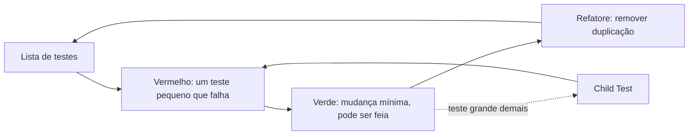

# TDD (Beck): ciclo, padrões e evidência

## 1. TL;DR

*Test Driven Development: By Example* (Kent Beck, Addison-Wesley, 2003) reduz o TDD a duas regras: escrever um teste automático que falhe antes de qualquer código de produção e remover duplicação. Delas sai o ciclo vermelho → verde → refatore, com três formas de chegar ao verde (Fake It, Triangulate, Obvious Implementation). A evidência empírica é **mista**: há ganho de qualidade em estudos industriais, com custo de produtividade, e o melhor estudo de processo sugere que o benefício vem dos **ciclos curtos e regulares**, não da ordem teste-antes. Para agentes de código, os primeiros estudos (preprints de 2026) indicam ganho grande quando o loop de testes é imposto.

## 2. Problema que resolve

- Código escrito "de uma vez" e testado depois: bugs descobertos tarde, testes escritos para passar no código que já existe.
- Escopo que cresce sem controle durante a implementação.
- Design especulativo: abstrações e flexibilidade criadas antes de existir necessidade.
- Medo de mudar o código, por falta de rede de segurança.

**[fato]** A meta declarada é *código limpo que funciona* (frase de Ron Jeffries). Beck separa as duas metades: primeiro "funciona", depois "limpo". Dependência é o problema central do software e duplicação é o sintoma; remover duplicação reduz dependência (cap. 1 da parte I).

## 3. Abordagens e trade-offs

### 3.1 As duas regras e o ciclo

**[fato]** O ciclo: (1) adicionar um teste pequeno; (2) rodar todos e ver falhar; (3) fazer a menor mudança que passa; (4) rodar todos e ver passar; (5) refatorar para remover duplicação, inclusive a duplicação entre teste e código. "Um verde rápido perdoa todos os pecados, por um momento."

**[fato]** No TDD, refactoring significa preservar os testes que passam (equivalência observacional). Ver o doc do Fowler para a disciplina de refactoring: [`software-engineering/practices/fowler-refactoring-2ed.md`](../practices/fowler-refactoring-2ed.md).

### 3.2 Três formas de chegar ao verde (cap. 28)

| Estratégia | Quando | Como | Custo |
|---|---|---|---|
| **Obvious Implementation** | Sabe a solução simples | Digita a solução ("segunda marcha") | Exige acertar; se aparecer vermelho inesperado, reduza a marcha |
| **Fake It** | Não sabe a implementação | Retorna uma constante e a transforma em expressão aos poucos | Verde imediato; a refatoração remove a duplicação teste ↔ código |
| **Triangulate** | Inseguro sobre a abstração | Só generaliza com dois ou mais exemplos | Mais lento; abandone quando ganhar confiança |

**[fato]** O tamanho do passo é adaptável: o domínio está em saber dar passos grandes quando tudo vai bem e encolher quando aparece surpresa. Exigir sempre Obvious Implementation vira perfeccionismo paralisante; abstrair com um único exemplo é prematuro.

**[fato] One to Many:** para operação sobre coleção, implemente para um item, adicione o parâmetro-coleção, migre e só então apague o escalar.

### 3.3 Escolha do próximo teste (caps. 25-26)

| Padrão | Uso |
|---|---|
| **Test List** | Antes de começar, liste os testes previstos (exemplos, casos nulos, refatorações). Tangentes que surgem vão para o fim da lista |
| **One Step Test** | Próximo teste = o que ensina algo **e** que você confia que consegue implementar |
| **Starter Test** | Primeiro teste de uma operação: variante degenerada (entrada mínima, operação que não faz nada) |
| **Regression Test** | Defeito relatado → o menor teste que o reproduz, antes da correção |
| **Learning Test** | Antes de usar uma API externa pela primeira vez, um teste que confirma o comportamento esperado. Roda de novo a cada versão |
| **Assert First** | Escreva o teste começando pela asserção e preencha de trás para frente |
| **Evident Data** | Dados que deixam visível a relação esperado ↔ real (ex.: `100 / 2 * (1 - 0.015)`); nunca a mesma constante para duas coisas |

**[fato]** Escrever vários testes de uma vez é anti-pattern: dez testes vermelhos significam um caminho longo até o verde e inércia para refatorar. Test First é **controle de escopo e de design**, não cerimônia.

### 3.4 Padrões de teste e de design (caps. 27-30)

| Situação | Padrão |
|---|---|
| Teste ficou grande demais | **Child Test**: um teste menor da parte que falha; depois reintroduz o maior |
| Recurso caro (banco, rede) | **Mock Object** respondendo com constantes |
| Testar comunicação entre objetos | **Self Shunt** (o próprio caso de teste é o colaborador) |
| Testar ordem de chamadas | **Log String** |
| Código de erro raro | **Crash Test Dummy**: objeto que lança exceção. "Código de erro não testado não funciona" |
| Teste de exceção | Capture só o tipo esperado e falhe se a exceção não ocorrer |

**[fato]** Asserções devem dizer o valor exato (`assertTrue(x != 0)` é fraco) e não depender da representação interna. Desejo de teste caixa-branca é sinal de falha de design.

**[fato]** Padrões de design (Value Object, Null Object, Composite, Template Method, Pluggable Object, Factory Method) **emergem** ao eliminar duplicação, não são desenhados antes. "Como fornecer uma variável global? Não forneça."

### 3.5 Quanto testar e quando parar (cap. 32)

- **[fato]** "Escreva testes até o medo virar tédio" (Phlip): condicionais, laços, operações e polimorfismo, só do **seu** código. Código de terceiros só com desconfiança específica.
- **[fato]** Quantos testes: calibre pelo tempo médio entre falhas (TMEF) desejado, não por permutações. No problema do triângulo, Beck escreve 6 testes; Bob Binder, 65.
- **[fato]** Apague um teste só se ele for redundante em **confiança** e em **comunicação** (ele conta um cenário diferente ao leitor?).
- **[fato]** Seguido à risca, o TDD do livro chega a ~100% de cobertura de comandos, como subproduto e não como meta.
- **[fato] Testes como canário:** setup longo → objetos grandes demais; setup duplicado difícil de fatorar → objetos entrelaçados; teste lento → partes difíceis de isolar; teste frágil → uma parte afeta outra de forma inesperada. Suíte completa em até ~10 minutos.
- **[fato] Fim de sessão:** sozinho, deixe um teste quebrado como marca de retomada; em time, só faça check-in com tudo verde. Comentar teste para passar é proibido.

### 3.6 Divergências com Khorikov e Fowler

| Tema | Beck | Khorikov / Fowler | Posição neste repo |
|---|---|---|---|
| Recurso caro (banco) | Mock Object com constantes | Khorikov: banco gerenciado real na integração; mock só em dependência não gerenciada | **[opinião]** Seguir Khorikov ([`khorikov-unit-testing.md`](khorikov-unit-testing.md)). O Mock Object de Beck é para isolar o teste unitário, não para substituir o teste de integração |
| Testar comunicação (Self Shunt, Log String) | Ferramenta normal | Khorikov: verificar interação só na fronteira com sistemas externos | **[opinião]** Usar só quando a interação é o contrato observável |
| Dados do teste | Evident Data: a expressão que deriva o resultado | Khorikov: valor esperado pré-calculado, sem lógica de produção | **[inferência]** Compatíveis: a expressão de Beck é aritmética legível, não reuso do código de produção |
| Fim de sessão solo com teste quebrado | Recomendado | Fowler: nunca refatorar com barra vermelha | **[inferência]** Sem conflito: o teste quebrado marca a próxima feature, não um refactoring em curso. Em trabalho de agente/time, vale o Clean Check-in |

### 3.7 Trade-offs

| Tensão | Posição do livro |
|---|---|
| Velocidade × disciplina | Passos pequenos quando há incerteza; segunda marcha quando há confiança |
| Design antecipado × emergente | "Codifique para amanhã, projete para hoje": o design emerge ao remover duplicação |
| TDD na aplicação inteira × aprendizado | Domine o ciclo sozinho antes de levar para o time ou para testes de aceitação (ATDD) |
| Legado | Não reescrever tudo ao adotar TDD; limitar o escopo às partes que mudam |
| Evangelização | "Nada mata a disseminação de TDD mais rápido que forçá-lo nos outros" |

## 4. Evidência

| Afirmação | Status |
|---|---|
| TDD reduz defeitos em contexto industrial | **Sustentada, com ressalvas.** Nagappan et al. (*Empirical Software Engineering*, 2008), 3 times da Microsoft e 1 da IBM: densidade de defeitos pré-release 40% a 90% menor que em projetos comparáveis sem TDD. Custo: 15% a 35% mais tempo inicial de desenvolvimento, **estimado subjetivamente** pelos times. São estudos de caso, não experimentos controlados |
| Efeito geral de TDD em qualidade e produtividade | **Inconclusivo.** Meta-análise de Rafique & Mišić (IEEE TSE, 2013), 27 estudos: sem evidência sólida a favor nem contra no agregado; efeito pequeno a favor da qualidade. Em estudos industriais, tanto o ganho de qualidade quanto a perda de produtividade foram bem maiores que em estudos acadêmicos |
| O benefício vem de escrever o teste **antes** | **Contestada.** Fucci et al. (IEEE TSE, 2017), 39 profissionais, 82 pontos de dados, TDD × iterative test-last: qualidade e produtividade se associaram à **granularidade** (ciclos curtos) e **uniformidade** (ciclos regulares), e a ordem teste-antes/teste-depois não teve influência importante |
| Design emerge de remover duplicação | **[opinião] do autor.** Não achei estudo que isole esse efeito |
| TMEF como critério de quantidade de testes | **[opinião] do autor**, heurística sem método de cálculo |
| TDD melhora agentes de código | **Indício inicial, preprints não revisados.** TDDev (arXiv, mai/2026): infraestrutura de TDD elevou a qualidade de geração de apps web em 34 a 48 pontos percentuais sobre baseline sem TDD, com a melhor estratégia de imposição dependendo do estilo do agente. TDAD (arXiv, mar/2026): mostrar ao agente os testes afetados pela mudança reduziu regressões de 6,08% para 1,82% no SWE-bench Verified com modelos locais. Não verifiquei status de revisão por pares |

**[opinião]** Resumo honesto: a evidência mais forte apoia **ciclos curtos com testes automatizados rodando o tempo todo**, não o ritual test-first em si. A ordem importa menos que o ritmo. Isso favorece a parte do método que um agente executa bem (passos pequenos, feedback constante) e enfraquece o argumento dogmático de "teste antes, sempre".

## 5. Aplicação prática

### 5.1 Backend

- Use o ciclo para lógica de domínio e algoritmos, onde Fake It e Triangulate brilham. Para orquestração com banco e bus, siga a estratégia de integração do Khorikov.
- **Regression Test** como hábito: todo bug corrigido entra com o teste que o reproduz, escrito antes da correção.
- **Learning Test** para SDKs de terceiros: protege contra mudanças de comportamento a cada upgrade.
- Em legado, TDD só no código que está mudando; para criar a rede de segurança, characterization tests (ver o doc do Fowler).
- A rule derivada deste doc está em [`rules/tdd.md`](../../rules/tdd.md).

### 5.2 Harnesses e agentes de IA

**[inferência]** O ciclo de Beck mapeia direto no loop de um agente: o teste vermelho é a especificação executável, o verde é o critério objetivo de parada e o refactor é uma fase com invariante verificável (testes continuam verdes).

Consequências **[opinião]**:

- **Teste vermelho antes do código evita o teste "escrito para passar".** Um agente que escreve código e testes juntos tende a ajustar o teste ao código. Exigir ver o teste falhar primeiro (e pelo motivo certo) é a defesa barata.
- **Proibir edição de teste na fase verde.** Na fase verde o agente só pode tocar código de produção; um hook pode bloquear mudança em arquivos de teste entre o vermelho e o verde.
- **Test List como plano do agente:** a lista de testes é um plano verificável, melhor que um plano em prosa. Tangentes vão para a lista em vez de virar mudanças fora do escopo.
- **Granularidade > ordem (Fucci):** para o harness, o que mais vale é rodar os testes a cada mudança pequena, com ciclos curtos e regulares. Isso também limita o tamanho do diff que precisa ser revisado.
- **Selecionar testes afetados (TDAD):** em suítes grandes, rodar só os testes relevantes a cada passo e a suíte toda no fim mantém o feedback rápido sem perder regressões.
- **Clean Check-in como critério de "pronto":** o agente só declara a tarefa concluída com a suíte verde; nunca comenta, pula ou enfraquece teste para chegar lá.
- **Fake It é arriscado sem a etapa de refatorar:** um agente que para no verde com constante hardcoded "passa" no teste e entrega código errado. Triangulate (um segundo exemplo) fecha essa brecha.

## 6. Fontes

- Beck, K. *Test Driven Development: By Example*. Addison-Wesley, 2003. Tradução brasileira: *TDD: Desenvolvimento Guiado por Testes*, Bookman, 2010.
- Base de conhecimento extraída da edição brasileira (skill `beck-tdd`, 32 capítulos em 12 arquivos, glossário, padrões e cheatsheet). Consultada em 2026-11-18.
- Nagappan, N.; Maximilien, E. M.; Bhat, T.; Williams, L. "Realizing quality improvement through test driven development: results and experiences of four industrial teams". *Empirical Software Engineering* 13(3), 2008. DOI: https://doi.org/10.1007/s10664-008-9062-z. Consultado em 2026-11-18.
- Rafique, Y.; Mišić, V. B. "The Effects of Test-Driven Development on External Quality and Productivity: A Meta-Analysis". IEEE TSE 39(6):835-856, 2013. DOI 10.1109/TSE.2012.28. Registro: https://researchr.org/publication/RafiqueM13. Consultado em 2026-11-18.
- Fucci, D. et al. "A Dissection of the Test-Driven Development Process: Does It Really Matter to Test-First or to Test-Last?". IEEE TSE, 2017. Preprint: https://arxiv.org/abs/1611.05994. Consultado em 2026-11-18.
- TDDev, estudo controlado de estratégias de TDD para geração de aplicações web por agentes (preprint, mai/2026): https://arxiv.org/html/2605.17242v1. Consultado em 2026-11-18.
- TDAD, análise de impacto para reduzir regressões de agentes (preprint, mar/2026): https://tldr.takara.ai/p/2603.17973 (resumo; arXiv 2603.17973). Consultado em 2026-11-18.
