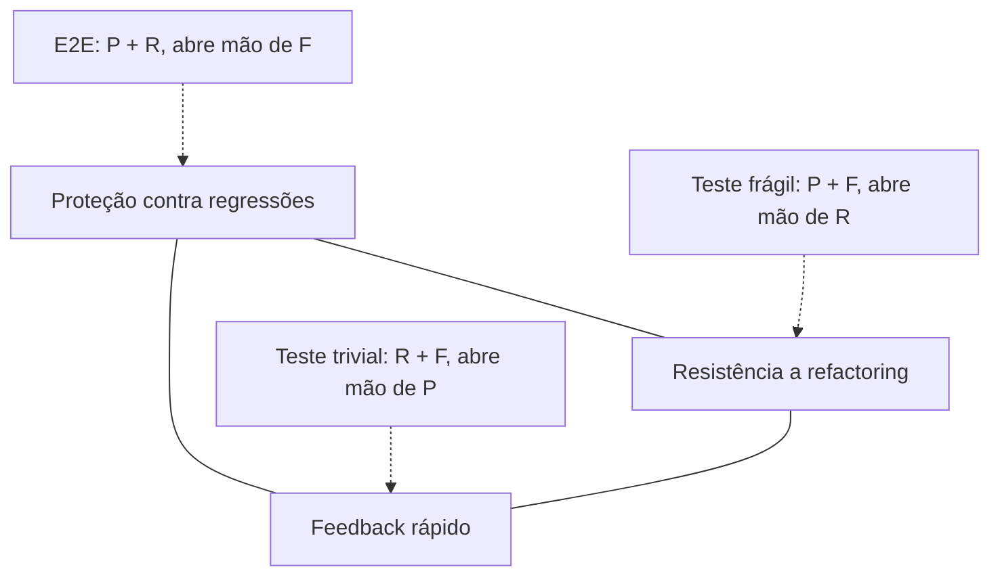

# Unit Testing (Khorikov): princípios, métricas e trade-offs

## 1. TL;DR

O livro *Unit Testing Principles, Practices, and Patterns* (Vladimir Khorikov, Manning, 2020) propõe medir todo teste automatizado (unit, integração ou E2E) por **4 pilares**: proteção contra regressões, resistência a refactoring, feedback rápido e manutenibilidade. O valor de um teste é o **produto** dos quatro. Resistência a refactoring é inegociável, então a escolha real fica entre proteção e velocidade. Daí saem as regras práticas: testar comportamento observável, preferir a escola clássica, usar banco real na integração e mock só em dependências out-of-process não gerenciadas.

## 2. Problema que resolve

Suítes de teste que crescem junto com o código, mas deixam de ajudar:

- testes que quebram a cada refactoring (falsos positivos), e o time passa a ignorar build vermelho;
- testes que passam com bug (falsos negativos);
- metas de cobertura que geram testes sem assert relevante;
- mocks em excesso, que acoplam o teste à implementação.

**[fato]** O objetivo declarado do livro é o **crescimento sustentável** do projeto: o teste existe para manter a velocidade de desenvolvimento ao longo do tempo, não para cumprir uma métrica. Código é passivo, não ativo, e isso vale para o código de teste: cada teste precisa pagar o próprio custo (cap. 1).

## 3. Abordagens e trade-offs

### 3.1 Os 4 pilares

**[fato]** Estrutura do capítulo 4 do livro ([Manning liveBook, cap. 4](https://livebook.manning.com/book/unit-testing/chapter-4)):

| Pilar | O que mede | Erro que combate |
|---|---|---|
| Proteção contra regressões | Quanto código e quanta lógica relevante o teste exercita | Falso negativo |
| Resistência a refactoring | Quanto o teste sobrevive a uma refatoração sem ficar vermelho | Falso positivo |
| Feedback rápido | Tempo de execução | Ciclo de desenvolvimento lento |
| Manutenibilidade | Facilidade de ler o teste e de rodá-lo (dependências) | Custo de manutenção |

**Valor do teste = Proteção × Resistência × Velocidade × Manutenibilidade**

**[fato]** Cada pilar recebe uma nota de 0 a 1 e as notas são multiplicadas. Um pilar zerado zera o teste. Manutenibilidade é quase independente dos outros três (a exceção são testes E2E, maiores e mais caros), então também deve ser sempre maximizada.

### 3.2 Precisão do teste (matriz de confusão)

| | Funcionalidade correta | Funcionalidade quebrada |
|---|---|---|
| **Teste passa** | Correto | **Falso negativo** (erro tipo II) |
| **Teste falha** | **Falso positivo** (erro tipo I) | Correto |

- Precisão do teste ≈ **sinal / ruído**. O sinal é achar bugs (proteção); o ruído são os alarmes falsos (inverso da resistência).
- **[fato]** O peso muda com a idade do projeto: no início, falsos negativos dominam; com o código maduro e refatorado com frequência, os falsos positivos se acumulam e corroem a confiança na suíte.
- **[fato]** Principal causa de falso positivo: acoplamento do teste a **detalhes de implementação** em vez do resultado final. Verifique o **quê**, não o **como**, do ponto de vista do usuário final.
- **[fato]** Black-box para **escrever** testes; white-box (cobertura) só para **analisar** a suíte. Teste que não rastreia até um requisito de negócio deve ser reestruturado ou apagado (cap. 4).
- **[fato]** Reagir à fragilidade parando de refatorar é a resposta errada: o certo é reavaliar e reduzir a fragilidade da suíte.

### 3.3 O trade-off: 2 de 3

| Tipo de teste | Maximiza | Abre mão de |
|---|---|---|
| End-to-end | Proteção, resistência | Velocidade |
| Trivial (getter, mapeamento óbvio) | Resistência, velocidade | Proteção |
| Frágil (verifica chamadas internas, SQL exato) | Proteção, velocidade | Resistência |

**[fato]** Como resistência a refactoring é praticamente binária (o teste acopla ou não acopla à implementação), ela deve ser maximizada sempre. O ajuste fino fica **entre proteção e velocidade**, e é isso que gera a **pirâmide de testes**. Nenhuma camada da pirâmide abre mão de resistência.

### 3.4 Escola clássica × Londres

| | Clássica (Detroit) | Londres (mockist) |
|---|---|---|
| "Unidade" | Unidade de **comportamento** (pode envolver várias classes) | Uma classe |
| "Isolamento" | Testes isolados **entre si** | Classe isolada dos colaboradores |
| Test doubles | Só para dependências compartilhadas/out-of-process | Para todo colaborador mutável |
| Risco principal | Falha localiza o bug com menos precisão | Acoplamento à implementação → falsos positivos |

**[fato]** Khorikov defende a escola clássica. A distinção vem de Fowler, em [Mocks Aren't Stubs](https://martinfowler.com/articles/mocksArentStubs.html).

### 3.5 Anatomia do teste (cap. 3)

| Seção | Tamanho ideal | Sinal de problema |
|---|---|---|
| Arrange | A maior (≈ Act + Assert) | Extrair para factory method, Object Mother ou Test Data Builder |
| Act | **Uma linha** | API do SUT vaza invariante (o cliente precisa lembrar de uma segunda chamada) |
| Assert | Pode ter vários asserts | Muitos asserts → falta abstração (ex.: igualdade no objeto) |
| Teardown | Normalmente nenhum | Necessário quase só em integração |

- **[fato]** Uma unidade de comportamento pode ter vários resultados; verificar todos no mesmo teste é correto. A regra "um assert por teste" é errada segundo o autor.
- **[fato]** Vários blocos AAA ou `if` no teste indicam mais de um comportamento: separe. Vários Acts só são tolerados em testes de integração já lentos, como otimização.
- **[fato]** Reuso de Arrange via **factory methods privados**, não campos inicializados no construtor/setup (acoplam testes e tiram a autossuficiência). Base class só para o que quase todo teste usa (ex.: conexão de banco).
- **[fato]** Nome do teste: fato em linguagem natural, sem o nome do método (`Delivery_with_a_past_date_is_invalid`, não `IsDeliveryValid_InvalidDate_ReturnsFalse`). Use "is", não "should be". Variações do mesmo fato viram teste parametrizado.

### 3.6 Estilos de teste (cap. 6)

Ordem de preferência por valor:

1. **Output-based** (funcional): entrada → saída, sem efeitos colaterais. Melhor resistência e manutenibilidade.
2. **State-based**: verifica o estado após a operação.
3. **Communication-based**: verifica interações via mocks. É o mais frágil.

Para viabilizar o estilo 1: **functional core, imperative (mutable) shell**. A lógica de decisão fica pura e os efeitos colaterais vão para as bordas, num fluxo **ler → decidir → agir**.

- **[fato]** Uma função matemática não tem entradas nem saídas ocultas. Efeitos colaterais e exceções são saídas ocultas; ler `DateTime.Now`, consultar o banco ou um campo mutável privado são entradas ocultas.
- **[fato]** O núcleo recebe **valores**, não colaboradores. Passar um `IDatabase` para o núcleo cria uma entrada oculta e mata o teste output-based.
- **[fato]** Functional architecture é hexagonal levada ao extremo: tira **todos** os efeitos colaterais do domínio.
- **[fato]** Custos: nem sempre é possível (consulta a dependência no meio do fluxo), aumenta chamadas out-of-process (desempenho) e o tamanho do código. O autor recomenda aplicar de forma estratégica, não em toda base.

### 3.7 Quatro tipos de código (cap. 7)

| | Poucos colaboradores | Muitos colaboradores |
|---|---|---|
| **Alta complexidade / significância de domínio** | Domain model, algoritmos → **teste unitário** | Código overcomplicated → **refatorar** (humble object) |
| **Baixa complexidade** | Código trivial → **não testar** | Controllers / orquestração → **poucos testes de integração** |

Técnicas para esvaziar o quadrante overcomplicated:

- **Humble Object:** extrair a lógica para um componente testável e deixar um invólucro fino que só delega.
- **CanExecute / Execute:** o domínio expõe a decisão (`CanExecute()`) e o controller a consulta antes de `Execute()`, mantendo condicionais fora da orquestração. Um guard dentro de `Execute()` protege contra chamada fora de ordem.
- **Domain events:** o domínio registra o que aconteceu; o controller converte os eventos em chamadas a dependências externas. Evita injetar logger ou bus no domínio.

### 3.8 Mocks e dependências (caps. 5, 8 e 9)

**Mock × stub [fato]:**

| | Mock | Stub |
|---|---|---|
| Interação | Saída (altera estado da dependência) | Entrada (fornece dados) |
| CQS | Substitui um command | Substitui uma query |
| Verificar a chamada? | Sim: a chamada é o resultado | **Nunca** (overspecification) |

**Observável × público [fato]:** são dois eixos independentes. API pública que expõe detalhe de implementação é ruim; uma boa API faz público e observável coincidirem. Sinal de vazamento: atingir um objetivo exige mais de uma operação na classe.

**Comunicação intra × inter-sistema [fato]:** chamadas entre classes da aplicação são detalhe de implementação. Chamadas que cruzam a fronteira da aplicação com efeito visível externamente são contrato, e mockar só faz sentido aí. O mesmo `verify` é correto ou frágil dependendo só disso.

| Dependência | Exemplo | Tratamento |
|---|---|---|
| In-process | Classes do domínio | Real |
| Out-of-process **gerenciada** (só sua app acessa) | Seu banco de dados | **Real**, em teste de integração; verificar estado final |
| Out-of-process **não gerenciada** (visível a outros sistemas) | SMTP, message bus, API de terceiros | **Mock**: a interação faz parte do contrato observável |
| Gerenciada **e** não gerenciada | Banco compartilhado | Tabelas visíveis a terceiros como não gerenciadas; o resto como gerenciado |

Boas práticas de mock (cap. 9) **[fato]**:

- Mock só em **testes de integração** (controllers). Testes do domain model não usam mock.
- Mock do **último** tipo antes do sistema externo (`IBus`), não de um wrapper intermediário (`IMessageBus`). Exercita mais código de produção e desacopla de detalhes internos.
- Verificar o **efeito observável** (o texto/payload da mensagem), não a chamada a uma classe própria.
- **Spy** escrito à mão, com API fluente e reutilizável, é preferível a `Verify` inline do framework na borda.
- Verificar a **quantidade** de chamadas: as esperadas existem (`Times.Once`) e não há outras (`VerifyNoOtherCalls`).
- Não usar constantes ou classes de produção no assert: isso gera **teste tautológico**. Duplique os literais no teste.
- Não existe regra de "um mock por teste": o número de mocks segue o número de dependências não gerenciadas.
- Mock só de tipos próprios (adapter sobre a lib de terceiro). Não vale embrulhar dependências in-process ou gerenciadas (data/hora, ORM).
- **Interface com uma só implementação não é abstração** (abstrações são descobertas, não inventadas). Crie interface só para dependência não gerenciada; para classe de domínio, é sinal de que se pretende mockar interação interna.

### 3.9 Integração (cap. 8)

- **[fato]** Teste de integração é qualquer teste que não é unitário. A barra é mais alta: ele precisa ganhar em proteção e resistência para compensar a pior manutenibilidade e velocidade.
- Um teste de integração para o **happy path mais longo** de cada caso de uso, passando por todas as dependências out-of-process. Extras só para edge cases que testes unitários não cobrem.
- **Fail fast:** edge case que derruba a operação na hora (precondição violada, config inválida) pode ser coberto por guard clause + teste unitário da precondição, sem teste de integração.
- **[fato]** Se não dá para usar a dependência gerenciada real, **não** escreva o teste de integração com ela mockada: um teste de baixo valor é pior que nenhum. Fique só com testes unitários do domínio.
- No Assert, leia o estado do banco de volta pelo mesmo código de leitura da aplicação, exercitando escrita e leitura.
- **Log de suporte** (exigido pelo negócio) é comportamento observável: teste, via um `DomainLogger` tratado como dependência não gerenciada. **Log de diagnóstico** não se testa. Logger sempre injetado, nunca via ambient context.
- Testabilidade estrutural: fronteira explícita do domínio, no máximo ~3 camadas, sem dependência circular (troque callback por valor retornado).
- E2E: no máximo um ou poucos, pelo happy path mais longo, verificando o banco **através** da aplicação e o bus diretamente.

### 3.10 Testes com banco de dados (cap. 10)

| Prática | Motivo |
|---|---|
| Schema (inclusive dados de referência) em controle de versão | Uma só fonte da verdade, com histórico |
| Entrega **migration-based**, migrações imutáveis | Data motion importa mais que conflito de merge após o primeiro release |
| Uma instância de banco por desenvolvedor, de preferência local | Evita interferência entre testes e bloqueio de mudanças |
| Mesmo SGBD da produção (fornecedor igual; versão pode variar) | Banco em memória diverge funcionalmente → falso positivo e falso negativo |
| Limpar dados residuais no **início** do teste | Limpar no fim falha se o build cai ou o debugger para |
| Testes de integração rodando em sequência | Isolamento sem esforço extra |
| Transação / unit of work separada para Arrange, Act e Assert | O Act fica igual à produção; cache do ORM não contamina o Assert |
| Não envolver o teste numa transação nunca commitada | Diverge do comportamento de produção |
| Não testar repositório nem dispatcher isoladamente | Mesmo custo de integração, proteção menor e sobreposta |
| Barra mais alta para testar leitura do que escrita | Escrita corrompe estado; leitura errada é menos grave |

Para encurtar: Object Mother no Arrange, decorator method no Act e assert fluente.

### 3.11 Métricas de cobertura

| Métrica | Limitação |
|---|---|
| Code coverage (linhas) | Manipulável por compactação de código; não mede asserts |
| Branch coverage | Ignora caminhos dentro de bibliotecas externas; também não mede asserts |

**[fato]** Posição do livro: cobertura é um **bom indicador negativo** (cobertura baixa indica teste insuficiente) e um **mau indicador positivo** (cobertura alta não prova qualidade). Transformá-la em meta gera incentivo perverso.

### 3.12 Anti-patterns (caps. 4, 6, 9 e 11)

| Anti-pattern | Correção |
|---|---|
| Testar método privado | Testar via comportamento observável. Se a cobertura não fecha: código morto (apagar) ou abstração faltando (extrair classe). Exceção: método privado que cumpre contrato real (ex.: construtor exigido pelo ORM) |
| Expor estado privado para o teste | Verificar o que a produção observa (ex.: o desconto, não o campo `_status`). Ampliar a API pública por testabilidade é má prática |
| Vazar conhecimento de domínio (reimplementar o algoritmo no assert) | Valor esperado pré-calculado, hardcoded, de fonte independente do SUT |
| Code pollution (flag `isTestEnvironment`) | Interface + fake. A interface é poluição leve e inofensiva |
| Mockar classe concreta para preservar parte do comportamento | Sinal de violação de SRP: separar lógica e gateway (humble object) e mockar a interface |
| Ambient context para tempo (`DateTimeServer.Now` estático) | Tempo injetado, de preferência como **valor**; o estático é dependência compartilhada que transforma unit em integração |
| Cadeia de mocks (mock que retorna mock) | Teste ilegível e frágil: reestruturar o código |
| Teste tautológico | Asserts com significado, sem reaproveitar constantes de produção |

## 4. Evidência

| Afirmação | Status |
|---|---|
| Cobertura não prediz bem a efetividade da suíte | **Sustentada empiricamente.** Inozemtseva & Holmes (ICSE 2014) geraram 31 mil suítes em 5 sistemas Java e mediram a efetividade por mutation testing. Controlando pelo tamanho da suíte, a correlação cai para baixa ou moderada, e formas mais fortes de cobertura não ajudaram mais. |
| 4 pilares e valor multiplicativo | **[opinião] do autor**, um modelo conceitual. Não achei estudo empírico validando a fórmula. As notas de 0 a 1 são subjetivas. |
| Escola clássica > Londres | **Controverso.** Defensores da escola de Londres (ex.: *Growing Object-Oriented Software, Guided by Tests*, Freeman & Pryce) argumentam que mocks guiam o design de interfaces. Fowler descreve as duas sem declarar vencedora absoluta. Não achei estudo controlado comparando as duas. |
| Mocks em excesso geram fragilidade | **Experiência documentada amplamente** (ex.: a discussão "Is TDD Dead?" entre Beck, Fowler e DHH, em que os três dizem mockar quase nada), mas é evidência anedótica, não quantitativa. |
| Pirâmide de testes | Heurística consagrada, contestada por modelos alternativos (ex.: "testing trophy", que enfatiza integração). **[inferência]** Em backends com banco gerenciado, a posição de Khorikov (banco real na integração) já fica próxima do troféu. O próprio livro admite achatar a pirâmide em apps CRUD simples. |
| Banco em memória como substituto gera falsos positivos/negativos | **[opinião] do autor**, sustentada por argumento técnico (diferenças de dialeto, constraints, isolamento entre SGBDs). Não procurei estudo quantitativo nesta revisão. |
| "Um assert por teste" é regra errada | **[opinião] do autor**, coerente com "unidade de comportamento". Contraria uma convenção comum, sem estudo empírico conhecido de nenhum lado. |

## 5. Aplicação prática

### 5.1 Sistemas backend

- Domain model puro, testado no estilo output-based ou state-based, sem mocks.
- Integração com banco **real** (ex.: banco efêmero em container, mesmo SGBD da produção), em vez de mockar repositório ou ORM. Limpeza no início, execução sequencial, unit of work por seção.
- Mock só em adapters de message bus, e-mail e APIs externas, verificando o payload e a contagem de chamadas.
- Código legado: código overcomplicated (lógica + I/O misturados) → extrair o núcleo de decisão (humble object, CanExecute/Execute, domain events) antes de escrever testes. Teste em cima do código acoplado tende a sair frágil.
- A rule derivada deste doc está em [`rules/testing.md`](../../rules/testing.md).

### 5.2 Harnesses e agentes de IA

**[inferência]** Os pilares se transferem quase direto para evals de agente:

| Pilar | Equivalente em eval de agente |
|---|---|
| Proteção contra regressões | O eval detecta piora real de capacidade (troca de modelo, prompt ou tool) |
| Resistência a refactoring | O eval não quebra quando o agente chega ao **mesmo resultado** por outro caminho |
| Feedback rápido | Custo e latência por execução (tokens, chamadas ao LLM) |
| Manutenibilidade | Facilidade de manter datasets, graders e fixtures |

Consequências **[opinião]**:

- **Verificar a trajetória exata de tool calls = teste communication-based.** Quebra no primeiro ajuste de prompt ou troca de modelo, gerando falsos positivos. Prefira verificar o **resultado/estado final** (arquivo gerado, PR aberto, resposta correta).
- **Exceção análoga à dos mocks:** quando a interação é o contrato observável (ex.: o agente **não pode** chamar `deploy` sem aprovação, ou precisa registrar um evento de auditoria), verificar a chamada é legítimo. É o equivalente à dependência não gerenciada, e vale a regra de contagem: a chamada esperada existe e nenhuma outra chamada sensível aconteceu.
- **Tools externas no eval:** sandbox/real para o que o harness "gerencia" (filesystem, repo de teste); stub/fake para o que tem efeito em sistemas de terceiros (Slack, Azure DevOps de produção).
- **Precisão do eval:** um eval com LLM-as-judge tem falsos positivos e negativos próprios. Medir a concordância do judge com rótulos humanos é o equivalente a medir a precisão do teste.
- **Gabarito pré-calculado:** usar o próprio modelo avaliado para gerar a resposta esperada é o análogo de "vazar conhecimento de domínio": o eval vira tautológico.
- **Functional core no harness:** decisões determinísticas (política de permissão, roteamento, compaction trigger) como funções puras que recebem valores, testáveis no estilo output-based, separadas do loop que chama o modelo.

## 6. Fontes

- Khorikov, V. *Unit Testing Principles, Practices, and Patterns*. Manning, 2020. ISBN 9781617296277. [Simon & Schuster (sumário)](https://www.simonandschuster.ca/books/Unit-Testing-Principles-Practices-and-Patterns/Vladimir-Khorikov/9781617296277). Consultado em 2026-11-17.
- Base de conhecimento extraída do livro (skill `khorikov-unit-testing`, capítulos 1-11, glossário, padrões e cheatsheet), usada na revisão das seções 3.5-3.12. Consultada em 2026-11-18.
- Manning liveBook, cap. 4, "The four pillars of a good unit test": https://livebook.manning.com/book/unit-testing/chapter-4. Consultado em 2026-11-17.
- Excerto do cap. 1 (site do autor): https://enterprisecraftsmanship.com/files/Unit-Testing-Chapter-1-Excerpt.pdf. Consultado em 2026-11-17.
- Tech Lead Journal #58, entrevista com Khorikov: https://techleadjournal.dev/episodes/58/. Consultado em 2026-11-17.
- Inozemtseva, L.; Holmes, R. "Coverage Is Not Strongly Correlated with Test Suite Effectiveness". ICSE 2014. DOI 10.1145/2568225.2568271. PDF: https://cs.ubc.ca/~rtholmes/papers/icse_2014_inozemtseva.pdf. Consultado em 2026-11-17.
- Fowler, M. "Mocks Aren't Stubs" (2007): https://martinfowler.com/articles/mocksArentStubs.html. Consultado em 2026-11-17.
- Thoughtworks, "Mockists are dead, long live classicists": https://www.thoughtworks.com/en-sg/insights/blog/mockists-are-dead-long-live-classicists. Consultado em 2026-11-17.
