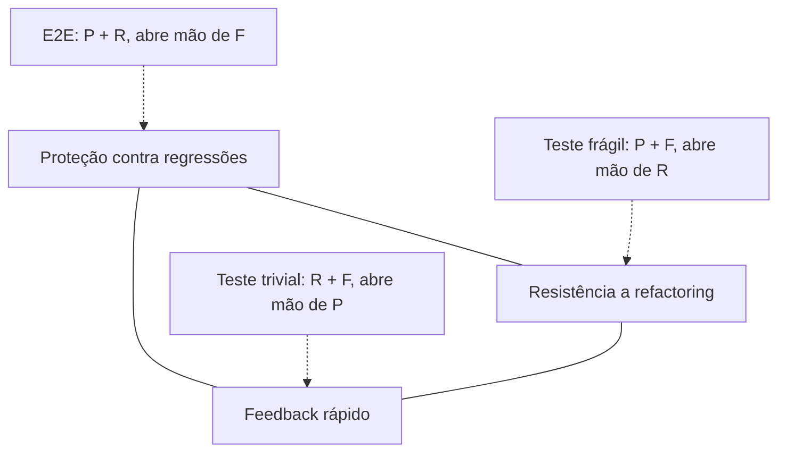

# Unit Testing (Khorikov): princípios, métricas e trade-offs

## 1. TL;DR

O livro *Unit Testing Principles, Practices, and Patterns* (Vladimir Khorikov, Manning, 2020) propõe medir todo teste automatizado (unit, integração ou E2E) por **4 pilares**: proteção contra regressões, resistência a refactoring, feedback rápido e manutenibilidade. O valor de um teste é o **produto** dos quatro. Resistência a refactoring é inegociável, então a escolha real fica entre proteção e velocidade. Daí saem as regras práticas: testar comportamento observável, preferir a escola clássica e usar mock só em dependências out-of-process não gerenciadas.

## 2. Problema que resolve

Suítes de teste que crescem junto com o código, mas deixam de ajudar:

- testes que quebram a cada refactoring (falsos positivos), e o time passa a ignorar build vermelho;
- testes que passam com bug (falsos negativos);
- metas de cobertura que geram testes sem assert relevante;
- mocks em excesso, que acoplam o teste à implementação.

**[fato]** O objetivo declarado do livro é o **crescimento sustentável** do projeto: o teste existe para manter a velocidade de desenvolvimento ao longo do tempo, não para cumprir uma métrica.

## 3. Abordagens e trade-offs

### 3.1 Os 4 pilares

**[fato]** Estrutura do capítulo 4 do livro ([Manning liveBook, cap. 4](https://livebook.manning.com/book/unit-testing/chapter-4)):

| Pilar | O que mede | Erro que combate |
|---|---|---|
| Proteção contra regressões | Quanto código e quanta lógica relevante o teste exercita | Falso negativo |
| Resistência a refactoring | Quanto o teste sobrevive a uma refatoração sem ficar vermelho | Falso positivo |
| Feedback rápido | Tempo de execução | Ciclo de desenvolvimento lento |
| Manutenibilidade | Facilidade de ler o teste e de rodá-lo (dependências) | Custo de manutenção |

**Valor do teste = Proteção × Resistência × Velocidade × Manutenibilidade**

**[fato]** Cada pilar recebe uma nota de 0 a 1 e as notas são multiplicadas. Um pilar zerado zera o teste.

### 3.2 Precisão do teste (matriz de confusão)

| | Funcionalidade correta | Funcionalidade quebrada |
|---|---|---|
| **Teste passa** | Correto | **Falso negativo** (erro tipo II) |
| **Teste falha** | **Falso positivo** (erro tipo I) | Correto |

- Precisão do teste ≈ **sinal / ruído**. O sinal é achar bugs (proteção); o ruído são os alarmes falsos (inverso da resistência).
- **[fato]** O peso muda com a idade do projeto: no início, falsos negativos dominam; com o código maduro e refatorado com frequência, os falsos positivos se acumulam e corroem a confiança na suíte.
- **[fato]** Principal causa de falso positivo: acoplamento do teste a **detalhes de implementação** em vez do resultado final.

### 3.3 O trade-off: 2 de 3

| Tipo de teste | Maximiza | Abre mão de |
|---|---|---|
| End-to-end | Proteção, resistência | Velocidade |
| Trivial (getter, mapeamento óbvio) | Resistência, velocidade | Proteção |
| Frágil (verifica chamadas internas) | Proteção, velocidade | Resistência |

**[fato]** Como resistência a refactoring é praticamente binária (o teste acopla ou não acopla à implementação), ela deve ser maximizada sempre. O ajuste fino fica **entre proteção e velocidade**, e é isso que gera a **pirâmide de testes**.

### 3.4 Escola clássica × Londres

| | Clássica (Detroit) | Londres (mockist) |
|---|---|---|
| "Unidade" | Unidade de **comportamento** (pode envolver várias classes) | Uma classe |
| "Isolamento" | Testes isolados **entre si** | Classe isolada dos colaboradores |
| Test doubles | Só para dependências compartilhadas/out-of-process | Para todo colaborador mutável |
| Risco principal | Falha localiza o bug com menos precisão | Acoplamento à implementação → falsos positivos |

**[fato]** Khorikov defende a escola clássica. A distinção vem de Fowler, em [Mocks Aren't Stubs](https://martinfowler.com/articles/mocksArentStubs.html).

### 3.5 Estilos de teste (cap. 6)

Ordem de preferência por valor:

1. **Output-based** (funcional): entrada → saída, sem efeitos colaterais. Melhor resistência e manutenibilidade.
2. **State-based**: verifica o estado após a operação.
3. **Communication-based**: verifica interações via mocks. É o mais frágil.

Para viabilizar o estilo 1: **functional core, imperative shell**. A lógica de decisão fica pura e os efeitos colaterais vão para as bordas.

### 3.6 Quatro tipos de código (cap. 7)

| | Poucos colaboradores | Muitos colaboradores |
|---|---|---|
| **Alta complexidade / significância de domínio** | Domain model, algoritmos → **teste unitário** | Código overcomplicated → **refatorar** (humble object) |
| **Baixa complexidade** | Código trivial → **não testar** | Controllers / orquestração → **poucos testes de integração** |

### 3.7 Mocks e dependências (caps. 5, 8 e 9)

| Dependência | Exemplo | Tratamento |
|---|---|---|
| In-process | Classes do domínio | Real |
| Out-of-process **gerenciada** (só sua app acessa) | Seu banco de dados | **Real**, em teste de integração |
| Out-of-process **não gerenciada** (visível a outros sistemas) | SMTP, message bus, API de terceiros | **Mock**: a interação faz parte do contrato observável |

Regras derivadas:
- Faça mock só de tipos que você controla (adapter próprio, não o SDK do terceiro).
- Verifique as interações na borda do sistema (a última classe antes da dependência externa).

### 3.8 Integração

- Um teste de integração para o **happy path mais longo** de cada caso de uso, passando por todas as dependências out-of-process.
- Testes de integração extras só para edge cases que testes unitários não cobrem.

### 3.9 Métricas de cobertura

| Métrica | Limitação |
|---|---|
| Code coverage (linhas) | Manipulável por compactação de código; não mede asserts |
| Branch coverage | Ignora caminhos dentro de bibliotecas externas; também não mede asserts |

**[fato]** Posição do livro: cobertura é um **bom indicador negativo** (cobertura baixa indica teste insuficiente) e um **mau indicador positivo** (cobertura alta não prova qualidade). Transformá-la em meta gera incentivo perverso.

### 3.10 Anti-patterns (cap. 11)

Testar métodos privados, expor estado privado só para teste, vazar conhecimento de domínio para o teste (reimplementar o algoritmo no assert), code pollution (código de produção que existe só para teste), mockar classes concretas e tratar tempo como dependência ambiente.

## 4. Evidência

| Afirmação | Status |
|---|---|
| Cobertura não prediz bem a efetividade da suíte | **Sustentada empiricamente.** Inozemtseva & Holmes (ICSE 2014) geraram 31 mil suítes em 5 sistemas Java e mediram a efetividade por mutation testing. Controlando pelo tamanho da suíte, a correlação cai para baixa ou moderada, e formas mais fortes de cobertura não ajudaram mais. |
| 4 pilares e valor multiplicativo | **[opinião] do autor**, um modelo conceitual. Não achei estudo empírico validando a fórmula. As notas de 0 a 1 são subjetivas. |
| Escola clássica > Londres | **Controverso.** Defensores da escola de Londres (ex.: *Growing Object-Oriented Software, Guided by Tests*, Freeman & Pryce) argumentam que mocks guiam o design de interfaces. Fowler descreve as duas sem declarar vencedora absoluta. Não achei estudo controlado comparando as duas. |
| Mocks em excesso geram fragilidade | **Experiência documentada amplamente** (ex.: a discussão "Is TDD Dead?" entre Beck, Fowler e DHH, em que os três dizem mockar quase nada), mas é evidência anedótica, não quantitativa. |
| Pirâmide de testes | Heurística consagrada, contestada por modelos alternativos (ex.: "testing trophy", que enfatiza integração). **[inferência]** Em backends com banco gerenciado, a posição de Khorikov (banco real na integração) já fica próxima do troféu. |

## 5. Aplicação prática

### 5.1 Sistemas backend

- Domain model puro, testado no estilo output-based ou state-based.
- Integração com banco **real** (ex.: banco efêmero em container), em vez de mockar repositório ou ORM.
- Mock só em adapters de message bus, e-mail e APIs externas.
- Código legado: código overcomplicated (lógica + I/O misturados) → extrair o núcleo de decisão (humble object) antes de escrever testes. Teste em cima do código acoplado tende a sair frágil.

### 5.2 Harnesses e agentes de IA

**[inferência]** Os pilares se transferem quase direto para evals de agente:

| Pilar | Equivalente em eval de agente |
|---|---|
| Proteção contra regressões | O eval detecta piora real de capacidade (troca de modelo, prompt ou tool) |
| Resistência a refactoring | O eval não quebra quando o agente chega ao **mesmo resultado** por outro caminho |
| Feedback rápido | Custo e latência por execução (tokens, chamadas ao LLM) |
| Manutenibilidade | Facilidade de manter datasets, graders e fixtures |

Consequências **[opinião]**:

- **Verificar a trajetória exata de tool calls = teste communication-based.** Quebra no primeiro ajuste de prompt ou troca de modelo, gerando falsos positivos. Prefira verificar o **resultado/estado final** (arquivo gerado, PR aberto, resposta correta).
- **Exceção análoga à dos mocks:** quando a interação é o contrato observável (ex.: o agente **não pode** chamar `deploy` sem aprovação, ou precisa registrar um evento de auditoria), verificar a chamada é legítimo. É o equivalente à dependência não gerenciada.
- **Tools externas no eval:** sandbox/real para o que o harness "gerencia" (filesystem, repo de teste); stub/fake para o que tem efeito em sistemas de terceiros (Slack, Azure DevOps de produção).
- **Precisão do eval:** um eval com LLM-as-judge tem falsos positivos e negativos próprios. Medir a concordância do judge com rótulos humanos é o equivalente a medir a precisão do teste.
- **Functional core no harness:** decisões determinísticas (política de permissão, roteamento, compaction trigger) como funções puras, testáveis no estilo output-based, separadas do loop que chama o modelo.

## 6. Fontes

- Khorikov, V. *Unit Testing Principles, Practices, and Patterns*. Manning, 2020. ISBN 9781617296277. [Simon & Schuster (sumário)](https://www.simonandschuster.ca/books/Unit-Testing-Principles-Practices-and-Patterns/Vladimir-Khorikov/9781617296277). Consultado em 2026-11-17.
- Manning liveBook, cap. 4, "The four pillars of a good unit test": https://livebook.manning.com/book/unit-testing/chapter-4. Consultado em 2026-11-17.
- Excerto do cap. 1 (site do autor): https://enterprisecraftsmanship.com/files/Unit-Testing-Chapter-1-Excerpt.pdf. Consultado em 2026-11-17.
- Tech Lead Journal #58, entrevista com Khorikov: https://techleadjournal.dev/episodes/58/. Consultado em 2026-11-17.
- Inozemtseva, L.; Holmes, R. "Coverage Is Not Strongly Correlated with Test Suite Effectiveness". ICSE 2014. DOI 10.1145/2568225.2568271. PDF: https://cs.ubc.ca/~rtholmes/papers/icse_2014_inozemtseva.pdf. Consultado em 2026-11-17.
- Fowler, M. "Mocks Aren't Stubs" (2007): https://martinfowler.com/articles/mocksArentStubs.html. Consultado em 2026-11-17.
- Thoughtworks, "Mockists are dead, long live classicists": https://www.thoughtworks.com/en-sg/insights/blog/mockists-are-dead-long-live-classicists. Consultado em 2026-11-17.
